# Stack-chan（スタックチャン）手挫完全指南 · 国内版

> 本文基于开源仓库 [stack-chan/stack-chan](https://github.com/stack-chan/stack-chan)（main 分支，固件 v1.1.0）与 M5Stack 官方 K151 产品文档（[中文](https://docs.m5stack.com/zh_CN/StackChan) / [English](https://docs.m5stack.com/en/StackChan)）整理。
> 配套的图片、外壳 STL、KiCad 底板工程、离线固件包都已放在本目录（见附录 A 文件清单），可离线使用。

---

## 0. 与官方文档核对后的要点（相比上一版教程的更新）

1. **官方有中文文档**：https://docs.m5stack.com/zh_CN/StackChan （K151 整机规格、出厂固件指南、App 使用）。
2. **整机国内直购**：M5Stack 官方淘宝店 https://m5stack.taobao.com ；StackChan 整机淘宝直链 https://item.taobao.com/item.htm?id=1042238294510 ；官方商城 $99（K151）/ $125（K151-R 带遥控手柄版）。
3. **K151 出厂固件生态全部开源**：[m5stack/StackChan](https://github.com/m5stack/StackChan)（出厂固件 + 遥控手柄固件 + iOS/Android App + 服务端），板级支持包 [m5stack/StackChan-BSP](https://github.com/m5stack/StackChan-BSP)。
4. **K151 官方机身结构文件**：[M5_Hardware/Products/K151_StackChan/Structures](https://github.com/m5stack/M5_Hardware/tree/master/Products/K151_StackChan/Structures)（10 个 STL，本包已附带，可用于魔改/复刻机身）。
5. **M5Burner v3 可刷/可恢复 K151 出厂固件**（Windows/macOS/Linux 三平台，下载见 7.7 节）；网页刷机工具（WebSerial）也支持简体中文界面。
6. **安全须知（官方原文警告）**：Y 轴（垂直）舵机角度控制在 **5°～85°**，超限可能堵转并造成**永久损坏**；X 轴无限制；**不确定通电状态时禁止用手硬掰**任何活动部件。
7. **App 兼容性**：StackChan World App **只能连接官方核心**（K151 整机 / 遥控套件 / 单独售卖的官方替换核心），**不能**连接第三方 CoreS3 / CoreS3-SE / CoreS3-Lite。
8. **离线固件包**：官方 release 提供 zip（含 4 个目标板的 esptool 三件套），本包已附带并通过 SHA-256 校验。
9. K151 机身**两个 USB-C 口都支持数据**（推荐用底部那个）；机身内置 550 mAh 电池、12 颗 RGB、红外收发、顶部三区触摸、全功能 NFC。
10. 固件 v1.1.0 新玩法：Stackchan Dock（安卓手机 USB 直连语音对话）、MCP Server MOD、MediaPipe BLE 面部/手势跟踪、XiaoZhi v1 兼容 ChatService。

---

## 1. Stack-chan 是什么

石川知也（meganetaaan）发起的开源"超可爱"桌面机器人：M5Stack 屏幕 + Avatar 表情库当脸，两个舵机做俯仰/偏航"脖子"，会点头、摇头、东张西望。硬件（外壳 STL、底板 KiCad 工程）和固件（Moddable SDK 上的 JavaScript/TypeScript，host + MOD 热装架构）全部开源。

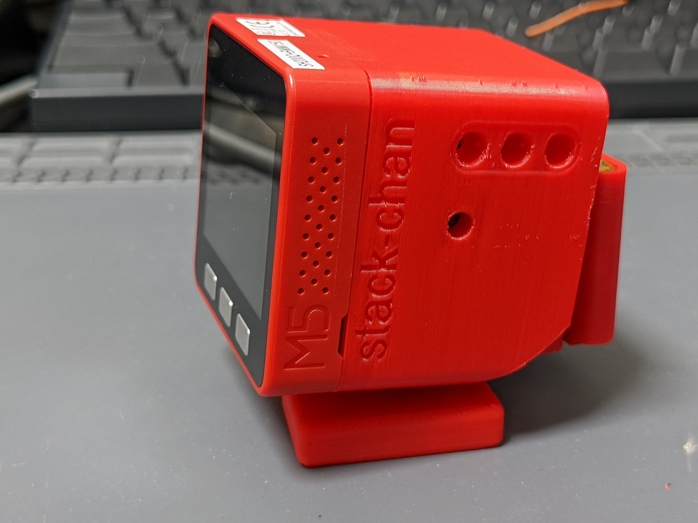

---

## 2. 先选一条路线

| 路线 | 内容 | 难度 | 预算（估） | 工期 | 适合 |
|---|---|---|---|---|---|
| **A. 整机 K151** | 淘宝/官方商城买整机，到手刷机即用 | ★ | ~¥700 上下（$99 / $125 + 运费） | 当天 | 只想玩、要 App/AI 功能 |
| **B. v1.0 自制** | CoreS3 + XL330 串行舵机×2 + 官方底板（打样）+ 打印壳 | ★★★★ | ~¥600–900（含主机） | 1–2 个周末 | 完整手挫、要串行舵机的性能（**专篇：[`v1-xl330-route/`](v1-xl330-route/README.md)**） |
| **C. v0 自制** | Core/Basic（或 Core2）+ SG90×2 + 官方底板（打样）+ 打印壳 | ★★★ | ~¥300–500（含主机） | 1 个周末 | 经典造型、性价比高 |
| **D. 丐版直插** | 已有 M5Stack + SG90×2 杜邦线直插端口（免底板免打板） | ★ | +¥30 即可（已有主机时） | 半天 | 快速验证兴趣 |
| **E. 零元体验** | 网页模拟器 + 积木编辑器，不买任何硬件 | — | ¥0 | 10 分钟 | 纯体验/预研 |
| **F. K151 官方机身复刻** | 官方 K151 结构 STL + CoreS3 + 2×Feetech SCS0009 串行舵机 + 二极管半双工直连（免底板） | ★★ | ~¥450–650（含主机） | 1 个周末 | 要官方造型与串行总线架构、不想打板 |

> 路线 E 入口：https://stack-chan.github.io/stack-chan/web/ （支持简体中文，含模拟器、积木编辑器、MOD Gallery、刷机器）

---

## 3. 国内采购指南

### 3.1 主机 / 整机（"主板"从哪买）

| 商品 | 渠道 | 说明 |
|---|---|---|
| **StackChan 整机（K151）** | 淘宝官方店直链：https://item.taobao.com/item.htm?id=1042238294510 | 官方直营；K151 = CoreS3 + 机身（550mAh 电池、双反馈舵机、12×RGB、红外、三区触摸、NFC、双 USB-C） |
| StackChan 遥控套件版（K151-R） | M5Stack 官方淘宝店 https://m5stack.taobao.com 搜 "StackChan"；官方商城 https://shop.m5stack.com/products/m5stackchan-ai-desktop-robot-kit-with-remote-control-esp32-s3 | 多一个 JoyC + StickC-Plus 组装的手柄遥控（ESP-NOW 遥控），$125 |
| **M5Stack CoreS3** | 官方淘宝店 https://m5stack.taobao.com （搜 CoreS3）；官方商城 https://shop.m5stack.com/products/m5stack-cores3-esp32s3-iotdevelopment-kit | 路线 B 的主机，约两百多 |
| M5Stack Core2 / Core Basic/Gray | 同上（官方淘宝店或商城） | 路线 C/D 的主机；Core2 有内置喇叭和电池 |
| 中文文档 | https://docs.m5stack.com/zh_CN/StackChan | 购买前后都可看 |

> 官方商城（Shopify）从深圳发货，支持国际卡；淘宝店对国内用户最方便、可开发票。M5Stack 是深圳公司，国内现货充足。
> **注意**：自己买 CoreS3 做"脸+脖子"属于自制路线；StackChan World App 只认官方核心（见第 0 节第 7 条）。

### 3.2 舵机选型（核心取舍）

| 舵机 | 类型 | 参考角（正前） | 国内渠道 | 特点 |
|---|---|---|---|---|
| **SG90 / MG90S** | PWM | 90° | 淘宝任意（¥5–15/个，MG90S 金属齿更耐用） | 便宜；涌流可能拉掉主机电源，堵转会过热冒烟（官方警告），不能读角度/断扭矩 |
| **SCS0009** | 串行 TTL | 100° | 深圳飞特（Feetech）产品，淘宝可直购 | 串行、可读角度；改 ID 需要 URT-1 调试器或手工工具 |
| **XL330-M288**（v1.0 新规格） | Dynamixel 串行 | 设 ID1=腿/ID2=脖，波特率 1M（默认 57600 需改） | Robotis 韩国品牌，淘宝有代理店；U2D2 调试器约 ¥200–300 | 功能最强（速度/扭矩/温度反馈）；v1.0 外壳官方配套 |
| **RS30X/RS304MD** | 串行 TTL | 0° | 日本 Vstone/Best Solution，国内需代购/转运（约 3000 日元+） | 官方文档认可，但国内获取成本高，不推荐 |

**给国内手挫的建议**：走丐版/性价比选 **SG90（MG90S 更稳）**；要体验串行舵机玩法选 **SCS0009**（本土品牌好买）或 **XL330**（走 v1.0 官方新规格）。

### 3.3 底板（servo driver board）

- **自己打**：官方开源 KiCad 工程，嘉立创打样，详见第 4 章（推荐）。
- **不想打板**：舵机直插 M5Stack 端口（杜邦线），引脚见 4.5 节；或参考日本 mongonta 的 M5Bottom 套件（booth 店需代购：https://mongonta.booth.pm/ ）。
- **买整机**：K151 机身自带驱动，无需底板。

### 3.4 电池与耗材

| 物料 | 规格 | 国内获取 |
|---|---|---|
| 锂电池 | 3.7V 400–640mAh（如 401230/501235）带 PH2.0-2P 插头 | 淘宝 ¥10–20 |
| 螺丝 | M2×4 自攻×4、M2×8 自攻×2；可选 M3×15×2；XL330 自带 M2.5×6 | 淘宝螺丝包 |
| 杜邦线 | 母对母/公对母若干 | 丐版直插必备 |
| PH2.0 端子线 | 2P 若干 | 接底板电池座 |
| 3D 打印 | PLA/PETG 约 30–50g | 自印或代打（见第 5 章） |

### 3.5 预算汇总（估算，以实际为准）

| 路线 | 主要开销 | 合计 |
|---|---|---|
| D 丐版（已有主机） | SG90×2 + 杜邦线 | **约 ¥30** |
| C v0 自制（含主机） | Core Basic/Core2 + SG90×2 + 打样 + 打印 + 电池 | **约 ¥300–500** |
| B v1.0 自制（含主机） | CoreS3 + XL330×2 + U2D2（一次性投入）+ 打样 + 打印 | **约 ¥600–900** |
| A 整机 K151 | 淘宝整机 | **约 ¥700 上下** |

---

## 4. 底板：买还是自己打（自己打详解）

### 4.1 这块板是什么

官方开源底板 `m5-pantilt`（KiCad 工程）位于仓库 `schematics/m5-pantilt/`，功能：

- 驱动两颗舵机（**PWM×2 或 串行×2**，同一块板按舵机类型选择焊装的器件与跳线）
- 通过 M5 Unit PortB 引出端口
- 外部 5V 供电口
- 电池供电，且**可经 M5Stack 给电池充电**
- （可选）电源开关


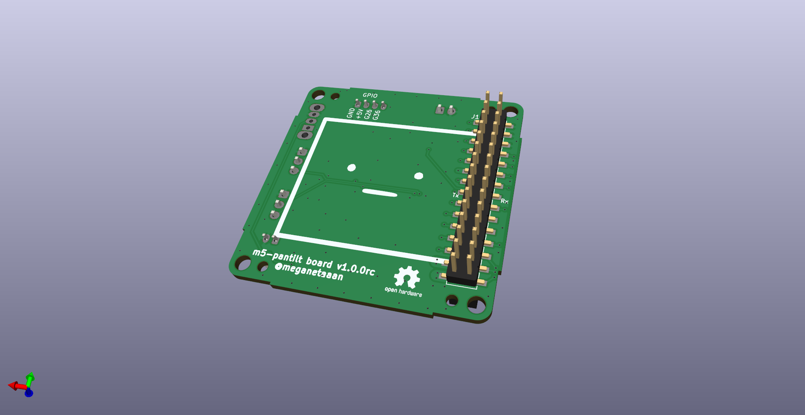

PWM 版（SG90）与串行版（SCS0009/RS30X/Dynamixel）的器件差别（跳线、缓冲 IC 等）详见实拍图与原理图：

| PWM 版 | 串行版 |
|---|---|
| 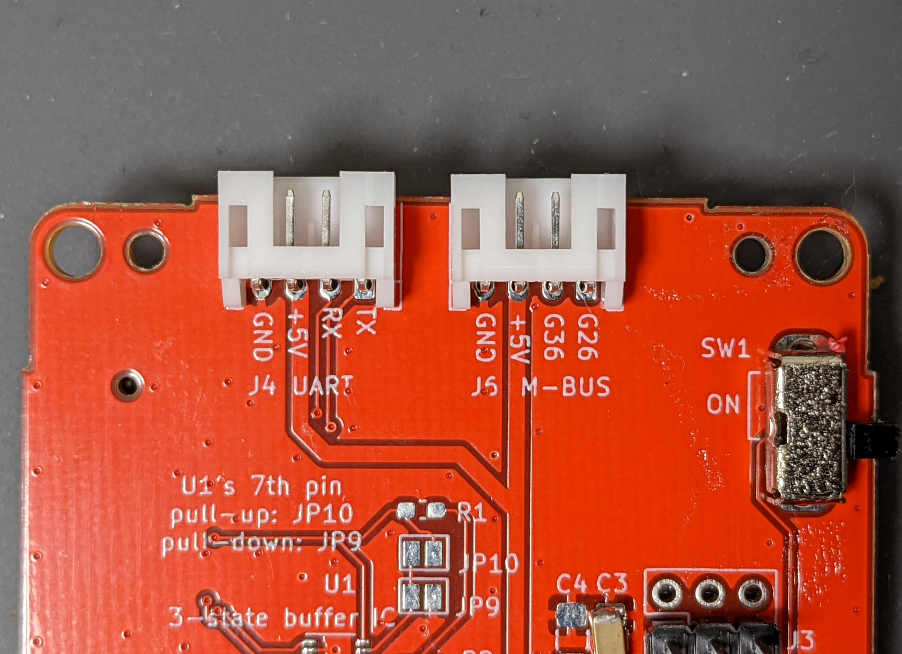 | 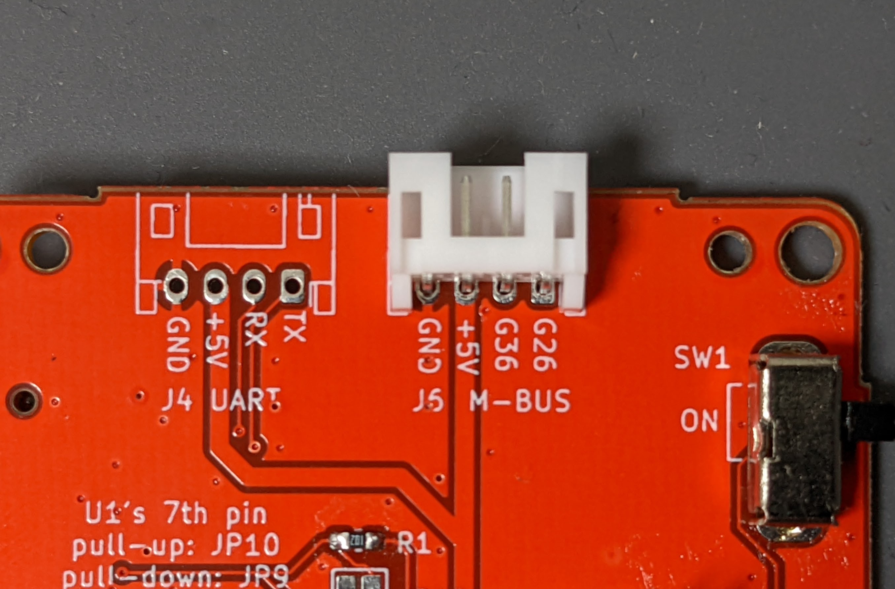 |
| 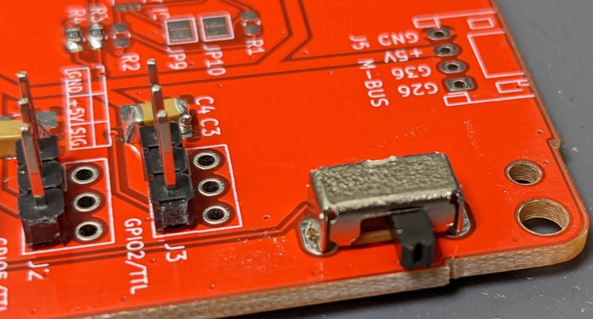 |  |

> 官方对比结论（原文翻译）：PWM/SG90 便宜但涌流可能导致 M5Stack 掉电，堵转过限可能冒烟；串行舵机能读角度、限速控制更精细，但贵。板上信号/供电见原理图 [images/m5-pantilt-sch.png] 与完整原理图 PDF（本包 `pcb/m5-pantilt-v1.0/m5-pantilt.pdf`）。

### 4.2 文件都在哪（本包已附带）

```
pcb/m5-pantilt-v1.0/
├── m5-pantilt.kicad_pro / .kicad_sch / .kicad_pcb   ← KiCad 工程（main 分支 = v1.0 规格）
├── m5-pantilt.pdf                                    ← 原理图 PDF（核对元件用）
├── m5-pantilt-all-pos.csv                            ← 贴片坐标（CPL），仓库官方提供
├── m5-pantilt.kibot.yaml                             ← KiBot 一键生成嘉立创制造文件的配置
├── gerber/                                           ← 仓库只提交了丝印 + 钻孔
│   ├── m5-pantilt-B_Silkscreen.gbo
│   ├── m5-pantilt-F_Silkscreen.gto
│   ├── m5-pantilt-NPTH.drl / m5-pantilt-PTH.drl
├── m5-pantilt.pretty/                                ← 自定义封装库
└── 其他工程配套文件（lib/sym-lib-table/cache 等）
```

**重要**：官方仓库只提交了丝印 + 钻孔（铜层 Gerber 在 `.gitignore` 里）。**本包已用 kicad-cli 生成全套制造文件**（`manufacture/jlcpcb/`，含铜层），不装 KiCad 也能直接下单；想自己生成或改板后重出，再用下面两种方法。

### 4.3 步骤一：生成制造文件（Gerber + BOM + 坐标）

**方法 A：KiBot 一键生成（推荐，配置官方已写好）**

1. 安装 [KiCad](https://www.kicad.org/)（建议 7/8 版本）与 KiBot：
   ```bash
   pip install kibot
   ```
2. 在 `pcb/m5-pantilt-v1.0/` 目录执行：
   ```bash
   kibot -c m5-pantilt.kibot.yaml -e m5-pantilt.kicad_sch -b m5-pantilt.kicad_pcb
   ```
3. 生成物在 `generated/` 下，其中 `Manufacturers/JLCPCB/` 是给嘉立创的 Gerber/BOM/坐标文件，另有 `BoM/Generic/` 的通用 BOM（HTML/XLSX）。

**方法 B：KiCad 手动导出（不装 KiBot）**

1. 用 KiCad 打开 `m5-pantilt.kicad_pcb` → 文件 → 制造输出 → Gerbers（导出含铜层+丝印+阻焊+钻孔，打包 zip）。
2. 贴片坐标：文件 → 制造输出 → 元件位置文件（.pos / .csv）；也可以直接用官方给的 `m5-pantilt-all-pos.csv`。
3. BOM：原理图工具 → BOM 导出（或直接对照 `m5-pantilt.pdf` 手抄，见 4.4）。

### 4.4 步骤二：核对元件清单（BOM）

**本包已生成完整制造文件**（`pcb/m5-pantilt-v1.0/manufacture/jlcpcb/`，由官方 KiCad 工程用 kicad-cli 导出）：Gerber zip、带 LCSC 编号的 BOM、贴片坐标 CPL，下单流程与跳线说明见 `pcb/m5-pantilt-v1.0/manufacture/README.md`。

完整 BOM 共 23 组（详见 `manufacture/jlcpcb/BOM.md`），核心元件：

| 类别 | 元件 |
|---|---|
| IC | U1 = MAX3485（半双工收发）、Q1 = IRLML6402（电源软开关）、Q2 = BC857（方向控制） |
| 二极管 | D1 = SS54、D2 = PMEG3030EP |
| 阻容 | 100µ×4、0.1µ×1；0603 电阻×15（**R13/R14 = 0Ω 跳线，串行舵机模式必装；R9–R12 = PWM 模式跳线，串行模式不装**） |
| 连接器 | J1/J2 = 2×15 M-BUS 排母/排针（**J1 在背面**）、J3/J8 = 舵机 3P 口、J5 = PH2.0 电池、J7 = XH 5V；手插件：J6、SW1 |

> 官方仓库自带的旧版 CPL 只有 3 个件，不完整；以生成版为准，下单前仍建议对照原理图 PDF 抽查。

### 4.5 步骤三：嘉立创下单（两种玩法）

**玩法 1：只打裸板，全部手焊（最省钱，元件少到 15 分钟焊完）**

1. 打开 https://www.jlc.com （嘉立创）→ PCB 下单。
2. 上传方法 A/B 生成的 Gerber 压缩包 → 自动解析。
3. 参数：2 层、板厚 1.6mm（按个人喜好 1.0 也行）、表面处理默认喷锡、数量 5 片。
4. 新客常有 5 片 ¥2 级别活动；提交付款，一般 2–4 天到货。
5. 到货后手焊：先 SMD（R1/R2/J1），再插件。J1 在**背面**立贴，焊接时注意方向（照 `images/m5-pantilt-bottom.png`）。

**玩法 2：让嘉立创 SMT 贴片（省焊接）**

1. PCB 下单时勾选 **SMT 贴片**，上传 BOM + 坐标（用 `m5-pantilt-all-pos.csv` 或方法 A 生成的 JLC 格式坐标）。
2. 元件匹配页面确认 J1/R1/R2。**注意 J1 在 bottom 面**：经济型贴装只贴单面，要么选双面贴装（贵一点），要么把 J1 改为免贴、到手自己焊。
3. 付款等待，到手后手焊剩余插件件。

**打样完成后**：万用表蜂鸣档查 5V/GND 是否短路，再上 M5Stack 试机。

### 4.6 不打板：舵机直插端口（丐版，零 PCB 成本）

官方固件文档明确给出了直插引脚（`manifest_local.json` 配置 `driver.type: "pwm"`）：

| 主机 | 端口 | pan（水平）引脚 | tilt（垂直）引脚 |
|---|---|---|---|
| M5Stack Core2 | Port.A | **GPIO 33** | **GPIO 32** |
| M5Stack Core2 | Port.C | **GPIO 13** | **GPIO 14** |
| M5Stack Core Basic/Gray | Port.C | **GPIO 16** | **GPIO 17** |

接线：每颗 SG90 三根线——信号（橙）接上表引脚、VCC（红）接 5V、GND（棕）接 GND。舵机吃电流，建议**外接 5V**（USB 充电器 + 杜邦线分压）并**共地**，否则 SG90 启动瞬间可能把主机拉掉电。

> 也可参考 mongonta 的 M5Bottom 方案（M5GO Bottom 底座 + SG90，免自制板）：装配图见 `images/m5go_assembly01.jpg` ~ `m5go_assembly11.jpg`。

### 4.7 老规格（v0.2.1 底板）

v0 外壳（Core/Basic + SG90/SCS0009/RS30X）对应的老板图纸在仓库 tag `v0.2.1`：
https://github.com/stack-chan/stack-chan/tree/v0.2.1/schematics
（main 分支上的是 v1.0 板，配 CoreS3 + XL330 + v1.0 外壳；两版不通用，按你选的外壳规格拿图纸。）

---

## 5. 3D 打印

### 5.1 打印文件清单（本包附带）

| 路线 | 目录 | 文件 |
|---|---|---|
| v1.0（XL330 + CoreS3） | `stl/v1-xl330/` | shell、feet_top、feet_bottom、bracket_XL330_f、bracket_XL330_b、gear_XL330（×2 颗）、gear_XL330_narrow（孔紧时的备选）、horn |
| v0（SG90 + Core/Basic） | `stl/v0-sg90/` | shell_SG90、feet_SG90、bracket_SG90_f、bracket_SG90_b、backpack_400mah（电池背包） |
| K151 官方机身（魔改参考） | `stl/k151-body/` | MainBody、Base、BaseCover、ServoBody、ServoArm、ServoCover、ServoSideCover、BearingFixture、LightGuideBar-A/B |

（STEP 可编辑源文件在仓库 `case/` 各目录，想改造型用 Fusion 360 / FreeCAD 打开。）

### 5.2 打印参数

- 材料：PLA 即可（ PETG 更韧）；约 30–50g。
- 层高 0.2mm；壳体薄壁件建议 3 层周壁。
- **官方推荐打印方向**（见下图，摆错方向强度差很多）：

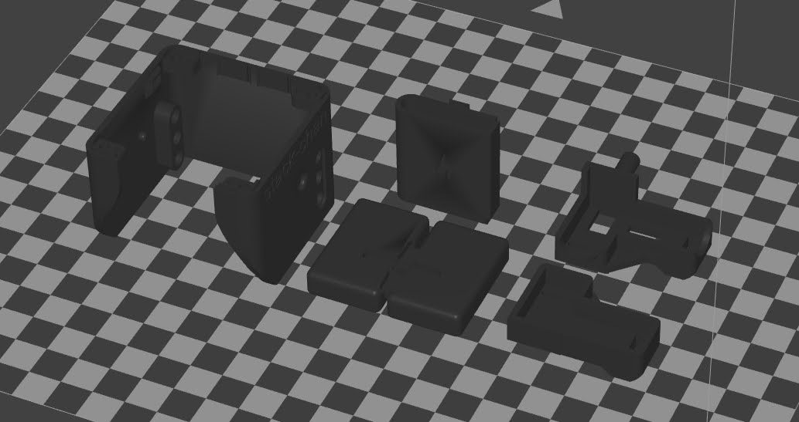

- `gear_XL330` 的孔公差按 3D 打印精度放大过：装上去晃就用 `gear_XL330_narrow`。

### 5.3 没有打印机？

- **嘉立创三维猴**：https://3d.jlcpcb.com （官方 v1.0 装配文档点名推荐 JLC 3D 打印，传 STL 即可，对国内最友好）
- 淘宝搜"3D打印代打"，按克计费，全套件几十元。
- DMM.make 等海外平台亦可（日本官方推荐，国内没必要）。

---

## 6. 机械装配

### 6.1 三条铁律（官方文档原文要求）

1. **先把固件刷好、舵机方向验证正确，再把舵机固定进壳**——装反通电就顶壳。
2. 安装舵机摇臂（horn/gear）时对准**参考角（正前方）**：

| 舵机 | 可动范围 | 参考角 |
|---|---|---|
| SG90 | 0–180° | **90°** |
| SCS0009 | 0–200° | **100°** |
| RS30X | −150~150° | **0°** |
| XL330 | — | 改好 ID 后以正前方装 gear |

3. 装配前把接线理顺、留出活动余量，别让线卡住旋转。

### 6.2 路线 B：v1.0 + XL330 的 10 步装配

先做舵机参数设置（需要 U2D2 + SMPS2Dynamixel + 5V 电源 + [Dynamixel Wizard 2](https://emanual.robotis.com/docs/en/software/dynamixel/dynamixel_wizard2/)）：

- **腿（pan，水平）舵机 → ID=1，脖子（tilt，垂直）舵机 → ID=2，波特率都改 1M**（默认 57600）。
- 改 ID 时**一次只连一颗**（同 ID 冲突会连不上）。


成品长这样（正/侧）：

| 正面 | 侧面 |
|---|---|
|  | 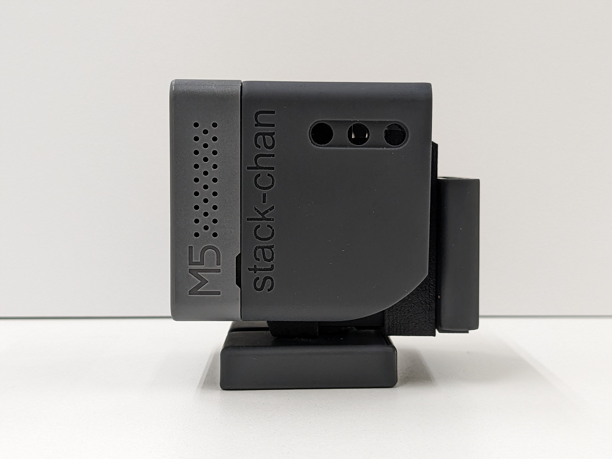 |

装配步骤（对应官方图 `dynamixel_01` ~ `dynamixel_10`）：

1. **腿舵机**：gear_XL330（小十字件）装到 ID=1 舵机上，对准凸起与孔：

   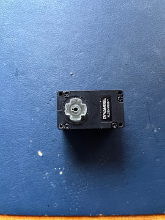

2. 装入 feet_top（带缺口凸起的一侧朝前），从背面 M2.5×6 自攻固定，再滑入 feet_bottom：

   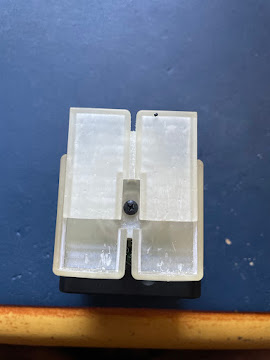

3. **脖子舵机**：同样给 ID=2 装 gear，M2.5×6 固定，再装 horn：

   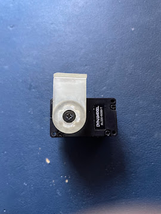

4. 接上舵机通信线（4cm 线 ×2）：

   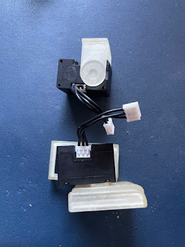

5. bracket_XL330_f 把上下两颗舵机组合起来：

   

6. bracket_XL330_b 背面锁紧：

   

7. 底板与两颗舵机连线：

   

8. horn 滑入 shell（外壳）：

   

9. 底板与外壳用 M2×4 盘头自攻锁 4 点：

   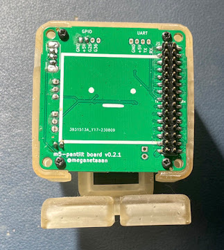

10. 插上 M5Stack（CoreS3），完成：

    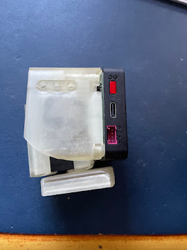

### 6.3 路线 C：v0 + SG90 装配（动图流程）

官方装配动图（GIF，用看图工具打开）：

| 1. 两颗舵机卡进 bracket + 电池入 backpack | 2. feet 与 shell 锁螺丝 | 3. 舵机/电池接底板 + 装 M5Stack |
|---|---|---|
| 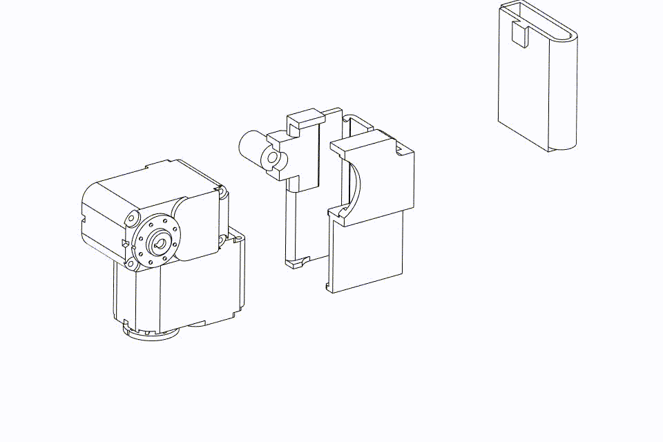 |  |  |

文字版流程：

1. 舵机先**不上壳**，接好线、刷固件，确认两颗舵机停在中位、方向正确。
2. 对准 90° 参考角装摇臂（十字盘凸起对齐）。
3. 两颗 SG90 卡进 bracket；电池塞进 backpack，卡进 bracket。
4. feet 和 shell 用 M2×8 各 1 颗固定。
5. 舵机线、电池线接底板（**仔细核对插针方向**）：

   

6. 底板 M2×4 ×4 锁到机身，M5Stack 插到 J1 排母上；想锁死主机用底部两孔 M3×15。

> mongonta（M5GO Bottom 版）的静态装配图：`images/m5go_assembly01.jpg` ~ `images/m5go_assembly11.jpg`，带壳+底座+装饰件（猫耳、河马耳、LEGO 孔）的玩法。

### 6.4 路线 C 变体：SCS0009 串行舵机

- 出厂前需给两颗舵机设不同 ID（ID1=脚/pan，ID2=脸/tilt），信号线接法见下图：

  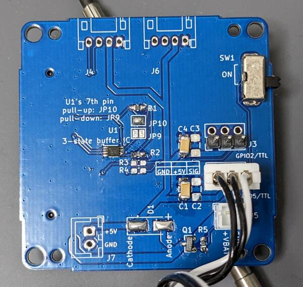

- 用飞特 URT-1 + 官方 GUI（fddebug）改 ID 和角度：

  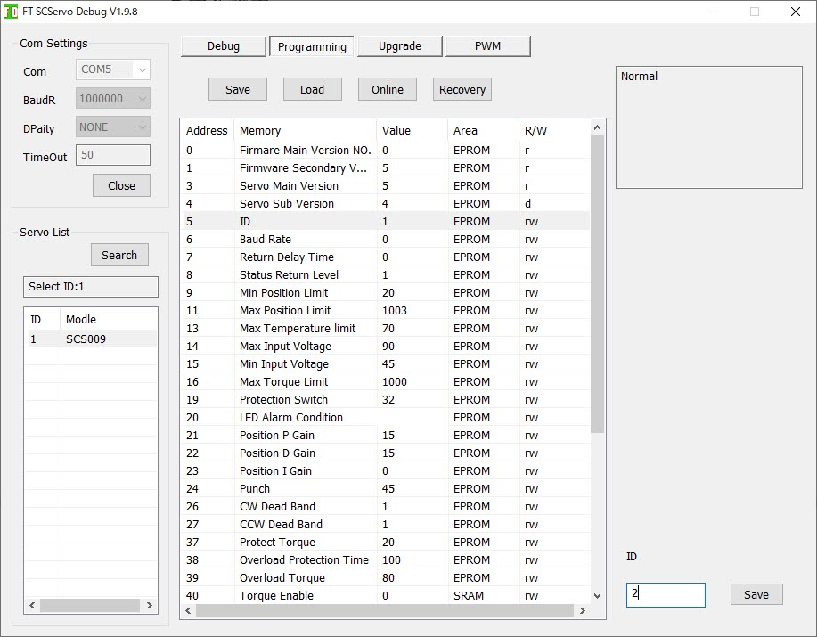

- **注意**：官方提醒不要用飞特 GUI 的 "Recovery"（已知会导致舵机工作异常）。

---

## 7. 固件

### 7.1 四种刷法怎么选

| 方式 | 门槛 | 适合 |
|---|---|---|
| 网页刷机（WebSerial） | 零环境 | 99% 的人，首选 |
| 离线 zip + esptool | 低 | 网页工具抽风/想脚本化 |
| npm 本地构建 | 中 | 要改代码、要 MOD 开发 |
| M5Burner | 低 | **K151 出厂固件**的安装/恢复 |

### 7.2 网页刷机（推荐）

1. Chrome/Edge 打开：https://stack-chan.github.io/stack-chan/web/flash/
2. 设备用**数据线**连电脑（K151 推荐底部 USB-C 口），选择设备型号（如 M5StackChan CoreS3）。
3. 按页面提示刷入。**会覆盖出厂固件**，恢复方法见 7.7。

> 网页工具全家桶（简体中文界面）：刷机 / BLE 设置 Wi-Fi / MOD Gallery / 积木编辑器 / 表情编辑器 / WASM 模拟器 / MediaPipe BLE 跟踪
> https://stack-chan.github.io/stack-chan/web/
> 开发预览版在 https://stack-chan.github.io/stack-chan/develop/web/ （一般用户用上面的稳定版）

### 7.3 离线包 + esptool（本包附带）

`firmware/stack-chan-firmware-v1.1.0.zip`（已通过官方 SHA-256 校验）内含 4 个目标：

| 目标 | 适配 |
|---|---|
| `m5stackchan_cores3` | K151 整机 |
| `com.m5stack.cores3` | CoreS3 裸机 |
| `com.m5stack.core2` | Core2 |
| `com.m5stack` | Core Basic/Gray |

（Stack-chan RT 与 Takao Core2+SG90 需从源码构建，不含在包内。）

每个目标文件夹是 esptool 三件套：`bootloader.bin` / `partition-table.bin` / `xs_esp32.bin`。安装 `esptool`（`pip install esptool`）后按 ESP-IDF 标准布局写入（S3：bootloader@0x0、partition-table@0x8000、app@0x10000；ESP32：bootloader@0x1000）：

```bash
esptool --chip esp32s3 --port /dev/ttyACM0 --baud 921600 \
  write_flash 0x0 bootloader.bin 0x8000 partition-table.bin 0x10000 xs_esp32.bin
```

> 偏移如有出入，以网页刷机或 npm 路线为准（它们会自动处理）。刷机会清空机身设置与已装 MOD（官方 v1.1.0 说明）。

### 7.4 npm 本地构建（开发路线）

官方在 Ubuntu 24.04 + Node 22 上实测（Windows 可用 WSL）：

```bash
git clone https://github.com/stack-chan/stack-chan.git
cd stack-chan/firmware
npm i
npm run setup                    # 自动装 Moddable SDK + ESP-IDF（基于 xs-dev）
npm run setup -- --device=esp32
npm run doctor                   # 自检：能看到 esp32 目标即成功
npm run flash                    # 标准机 M5StackChan CoreS3
```

其他硬件目标（子平台已预置驱动类型和引脚，**不要**自己加 `--target`）：

| 板子 | 构建烧录 | 驱动 |
|---|---|---|
| M5StackChan CoreS3（K151） | `npm run flash` | m5stackchan（串行 TX6/RX7） |
| Stack-chan RT | `npm run flash:stackchan_rt` | dynamixel（TX7/RX6） |
| Takao Core2 + SG90 | `npm run flash:takao_core2_sg90` | pwm（pan 19 / tilt 27） |

还有 `npm run build / deploy / debug / debug:xsdb` 各目标的同名变体；不需要 `sudo`。

### 7.5 驱动配置（自制接线必改）

编辑 `stack-chan/firmware/host/app/manifest_local.json`（仓库里就是留白的本地配置文件）：

```json
{
  "include": ["./manifest.json"],
  "config": {
    "driver": {
      "type": "pwm",
      "pwmPan": 33,
      "pwmTilt": 32
    }
  }
}
```

| 配置项 | 可选值 | 说明 |
|---|---|---|
| `driver.type` | `m5stackchan` / `scservo` / `rs30x` / `pwm` / `dynamixel` / `none` | 舵机驱动类型 |
| `driver.panId` / `tiltId` | 1–254 | 串行舵机 ID（pan=水平/腿，tilt=垂直/脖子） |
| `driver.offsetPan` / `offsetTilt` | −90~90 | 机械零位微调 |
| `tts.type` | `local` / `voicevox` / `voicevox-web` / `elevenlabs` / `openai` / `remote` | 语音合成 |
| `tts.host` / `tts.port` / `tts.volume` | — | TTS 服务器与音量 |

**验收标准（官方原文）**：装好后按 A 键每 5 秒随机看向一处、B 键依次看向左右上下、C 键表情反色。**会左右摇头 = 驱动配置成功。**

### 7.6 MOD：应用热装

host 只刷一次，之后秒级换"应用"：

```bash
npm run mod -- ./mods/examples/look_around/manifest.json
# 多设备时指定串口：
npm run mod -- ./mods/examples/look_around/manifest.json --port /dev/ttyACM1
```

不想写代码用网页积木编辑器；想擦掉 MOD 回默认行为用 `npm run erase-flash`（注意会清整个 flash，含设置）。

### 7.7 K151 出厂固件与 App（整机路线）

**出厂固件恢复/更新（M5Burner）**：

1. 下载 M5Burner v3：[Windows](https://m5burner-cdn.m5stack.com/app/M5Burner-v3-beta-win-x64.zip) · [macOS](https://m5burner-cdn.m5stack.com/app/M5Burner-v3-mac-x64.dmg) · [Linux](https://m5burner-cdn.m5stack.com/app/M5Burner-v3-beta-linux-x64.zip)
2. 打开 M5Burner → 搜索 **StackChan** → 勾选 **Only Official** → Download。
3. USB-C 连接（建议底部口）→ 烧录。

**StackChan World App**（视频查看、远程化身控制、App Center 等）：

- iOS：https://apps.apple.com/us/app/stackchan-world/id6756086326
- Google Play：https://play.google.com/store/apps/details?id=com.m5stack.stackchan
- **APK 直装包**（国内友好，深圳 OSS 直链）：https://m5stack-doc.oss-cn-shenzhen.aliyuncs.com/1205/StackChan_World_apk.zip

**出厂固件生态源码**（全开源）：https://github.com/m5stack/StackChan

### 7.8 其他开发方式（K151 官方教程）

- UiFlow2 图形化：https://docs.m5stack.com/en/uiflow2/stackchan/program
- Arduino IDE：https://docs.m5stack.com/en/arduino/stackchan/program
- Qoder 伴侣机器人固件：https://docs.m5stack.com/en/guide/stackchan/qoder
- 社区 Arduino 项目：AI Stack-chan（ChatGPT 语音对话）https://github.com/robo8080/AI_StackChan2 ；PWM 舵机测试 https://github.com/mongonta0716/stack-chan-tester

---

## 8. 开机验收与首次设置

### 自制路线

1. 检查所有接线（舵机、电池、底板方向）。
2. USB 供电开机 → 屏幕出现 Avatar 脸。
3. 按 A/B/C 键测试（见 7.5 验收标准）。
4. `npm run mod -- look_around` 试装一个 MOD。

### K151 整机（官方流程）

1. 装好 App（见 7.7），注册/登录 M5Stack 账号（与 UiFlow、M5Burner、论坛同一账号）。
2. 底部 USB-C 供电或左侧短按电源键开机 → 屏幕显示欢迎页。
3. 点 Start → **把机器人放在稳固平整桌面、不要碰它** → 再点 Start 开始**舵机自检**。

### 安全须知（官方原文）

- **Y 轴（垂直）舵机角度保持 5°～85°**，极端角度可能堵转并造成**永久损坏**；X 轴无限制。
- **不确定电机是否通电/受控时，禁止用手硬旋转任何活动部件**——可能损坏硬件。
- 通电状态下不要拧它的头（尤其串行舵机扭矩常开）。

---

## 9. 进阶玩法（v1.1.0 已内置/可选装）

- **语音对话**：ChatGPT MOD（`mods/examples/chatgpt`）、Codex Voice、XiaoZhi v1 兼容 ChatService（Opus 语音）、OpenAI Realtime 直连。
- **Stackchan Dock**：安卓手机 USB 直连 CoreS3，用机身麦克风/喇叭做语音对话。
- **MCP Server MOD**：让 Stack-chan 变成 MCP 工具端（记得设 `mcp.token` Bearer 认证）。
- **MediaPipe BLE 跟踪**：摄像头捕捉你的脸/表情/手势，机器人实时模仿（`mods/examples/mediapipe_ble` + 网页工具 https://stack-chan.github.io/stack-chan/web/mediapipe/ ）。
- **TTS**：VOICEVOX / ElevenLabs / OpenAI，`tts.type` 一行配置。
- **表情/积木**：网页表情编辑器自定义脸 + 积木编辑器拖积木出 MOD。
- 更多示例 MOD：`firmware/mods/examples/`（look_around、face_tracker、mimic_follow、lip_sync、web_radio、monologue、cheerup 等）。

---

## 10. 避坑清单（含官方原话警告）

1. **舵机零位没对准就装壳** → 通电顶壳、堵转、烧舵机。先刷固件验证方向再固定（官方要求）。
2. **SG90 涌流拉掉主机电源** → 舵机单独 5V 供电、与主机共地；堵转过限"可能过热冒烟"（官方原话）。
3. **Y 轴超 5°~85°** → 堵转永久损坏（官方原话）；写 MOD 时注意限位。
4. **串行舵机同 ID** → 改 ID/参数时一次只接一颗。
5. **飞特 GUI 的 "Recovery" 别用**（官方确认有坑）。
6. **烧录不用 sudo**；刷固件会清掉设置和 MOD。
7. **跟着 release 走**，develop 分支 API 会变。
8. **别手动跑 `mcconfig/mcrun/mcpack`**，用仓库 npm 脚本（会管理 dist/ 输出目录）。
9. **自制接线的 CoreS3**：直插引脚方案官方只给了 Core2/Core Basic 的表；CoreS3 裸机建议走 K151 或打板路线。
10. **J1 排母在底板背面**：嘉立创经济贴装是单面，注意选双面贴或 J1 免贴手焊。
11. **App 只认官方核心**：自制 CoreS3 机器不能用 StackChan World App，用开源固件的网页工具生态。

---

## 附录 A：本仓库文件清单

```
stackchan-diy-guide/  （本仓库）
├── README.md                       ← 本教程（Markdown 版，GitHub 直接渲染）
├── StackChan手挫完全指南.pdf        ← PDF 版（23 页 A4，图片内嵌）
├── index.html                      ← 网页版（浏览器打开，GIF 动图会动；可直接开 GitHub Pages）
├── LICENSE                         ← Apache-2.0（随上游 stack-chan 仓库）
├── images/                           ← 45 张官方装配图/动图/板子实拍（正文已引用）
├── stl/
│   ├── v1-xl330/    （8 件：v1.0 外壳全家桶）
│   ├── v0-sg90/     （5 件：v0 SG90 外壳 + 400mAh 电池背包）
│   ├── k151-body/   （10 件：K151 官方机身结构，魔改参考）
│   └── backpack/    （3 件：官方电池背包 400mAh / 640mAh / AAA 规格）
├── v1-xl330-route/                  ← 路线 B 专篇（v1.0 官方外壳 + XL330：方案/BOM/装配/固件）
│   ├── README.md
│   ├── images/       （21 张：v1.0 官方装配图/成品图/底板实拍）
│   ├── reference/    （官方 v1.0 装配指南原文 EN/JA）
├── k151-body-route/                 ← 路线 F 专篇（官方机身复刻：方案/BOM/接线/教程）
│   ├── README.md
│   ├── images/       （20 张：K151 官方产品图 + 文档截图）
│   └── datasheets/   （7 份 PDF：SCS0009 舵机、PY32L020、INA226、Si12T、ST25R3916、IRM56384、AW9523B）
├── pcb/
│   └── m5-pantilt-v1.0/  （KiCad 完整工程 + 原理图 PDF + kibot 配置 + 丝印/钻孔）
│       └── manufacture/  （已生成的嘉立创制造文件：Gerber zip + BOM(含LCSC号) + CPL + BOM.md + 下单说明）
└── firmware/
    ├── stack-chan-firmware-v1.1.0.zip        （官方预编译固件，4 目标 ×3 件，SHA-256 已验）
    └── stack-chan-firmware-v1.1.0.zip.sha256
```

## 附录 B：链接汇总

**开源项目**

- 主仓库（固件/外壳/底板/文档）：https://github.com/stack-chan/stack-chan
- 网页工具（刷机/设置/Gallery/编辑器/模拟器，中文）：https://stack-chan.github.io/stack-chan/web/
- 离线固件 release：https://github.com/stack-chan/stack-chan/releases/latest
- M5Stack 出厂生态：https://github.com/m5stack/StackChan ｜ BSP：https://github.com/m5stack/StackChan-BSP
- K151 机身结构：https://github.com/m5stack/M5_Hardware/tree/master/Products/K151_StackChan/Structures
- AI Stack-chan（Arduino）：https://github.com/robo8080/AI_StackChan2
- PWM 测试固件（Arduino）：https://github.com/mongonta0716/stack-chan-tester
- mongonta 套件（日本）：https://mongonta.booth.pm/

**购物**

- M5Stack 官方淘宝店：https://m5stack.taobao.com
- StackChan 整机淘宝直链：https://item.taobao.com/item.htm?id=1042238294510
- 官方商城（$99/$125）：https://shop.m5stack.com/products/stackchan-kawaii-co-created-open-source-ai-desktop-robot
- 嘉立创 PCB：https://www.jlc.com ｜ 三维猴 3D 打印：https://3d.jlcpcb.com

**文档**

- M5Stack 中文产品文档：https://docs.m5stack.com/zh_CN/StackChan
- 固件开发文档（克隆仓库后看 `firmware/docs/`）：getting-started / flashing-firmware / api / mods
- Dynamixel Wizard 2：https://emanual.robotis.com/docs/en/software/dynamixel/dynamixel_wizard2/
- Moddable SDK：https://github.com/Moddable-OpenSource/moddable
- 社区 Discord：https://discord.gg/eGhd9adnBm
- 纸书（日文，手挫圣经）：《つくれる！スーパーカワイイ ロボット スタックチャン》O'Reilly Japan, 2022

---

## 附录 C：来源与致谢

| 内容 | 来源 | 许可 |
|---|---|---|
| 外壳 STL、底板 KiCad 工程、装配图/动图、预编译固件 v1.1.0 | https://github.com/stack-chan/stack-chan | Apache-2.0 |
| K151 官方机身结构 STL（10 件） | https://github.com/m5stack/M5_Hardware（版权归 M5Stack） | 见原仓库 |
| K151 规格与安全须知、M5Burner / App 下载渠道 | https://docs.m5stack.com/zh_CN/StackChan | 官方文档 |
| M5GO Bottom 版装配图 | mongonta（Takao Akaki），经 stack-chan 仓库 contributed 目录收录 | 见原仓库 |

- 本仓库（教程文字部分除外）均为上述开源资料的转存汇总，供个人复刻学习使用；商用或二次分发前请确认上游许可。
- 教程文字由 Ekko Agent 受仓库主人委托整理，欢迎纠错 PR。

*祝手挫顺利。装配口诀：先刷固件、对准零位、再锁螺丝。*
