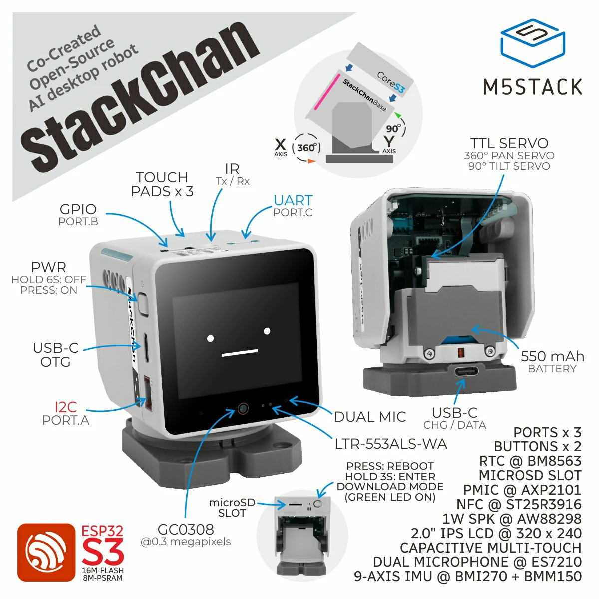
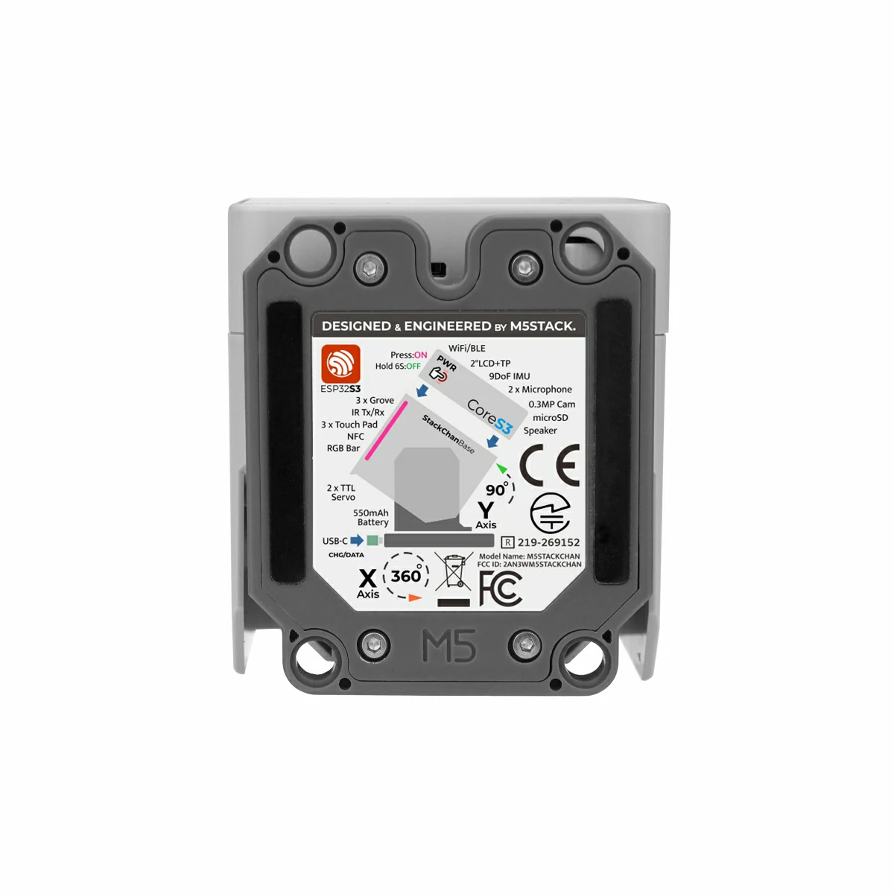

# K151 官方机身手搓路线：方案与完整教程

> 本目录是主教程《[StackChan 手挫完全指南](../README.md)》的一个独立子路线：
> **用官方 K151（StackChan）机身的结构文件，自己采购/配置电子件，搓出一台"架构与官方一致"的 Stack-chan**。
> 所有图片、数据手册、STL 引用均为本包离线文件（见附录），相对路径引用，可离线阅读。



---

## 0. 一句话结论（先看这个）

- K151 官方机身用的是 **Feetech SCS0009 串行总线舵机**（官方文档硬件清单原文：`Servo Motor SCS0009`，M5Stack 托管的[数据手册](datasheets/SCS0009_Feetech_Servo.pdf)已附本包）。
- 机身 10 个结构 STL **完全开源**（CC-BY-SA，`m5stack/M5_Hardware` 仓库），本包已附带在 [`../stl/k151-body/`](../stl/k151-body/)。
- 官方"底板"（带 PY32L020 扩展、12 颗 SK6812 灯、INA226 电量计的驱动板）**PCB 不开源**——但它的本质就是：**把 CoreS3 背面 M-BUS 的 GPIO6/GPIO7（21/22 脚）转成 SCS 半双工总线，给舵机供电**。
- 所以手搓路线 = **官方 STL 机身 + CoreS3 + 2×SCS0009 + 几块钱的半双工接线**，固件刷官方 `m5stackchan_cores3` 目标（或源码构建 `scservo` 驱动），协议、引脚、波特率与官方完全一致。

**预算（估算）：¥450–650**（CoreS3 ¥199–249 + 2×SCS0009 ¥120–180 + 打印 ¥50–100 + 杂件 ¥50–100）。

---

## 1. K151 官方架构解析（逆向自官方源码与文档）

以下全部来自官方公开资料：M5Stack 产品文档硬件清单、`m5stack/StackChan-BSP`（Arduino BSP，MIT）、`m5stack/StackChan`（出厂固件）、`stack-chan/stack-chan`（社区固件 `m5stackchan_cores3` 平台清单）。**不是猜测，每条都给了出处。**

### 1.1 硬件组成

| 部件 | 官方型号 | 说明 |
|---|---|---|
| 主控 | M5Stack CoreS3（K128） | ESP32-S3，2" 触摸屏 + GC0308 摄像头 + 麦克风 + 喇叭 |
| 水平舵机（pan/yaw，ID=1） | Feetech SCS0009（M5 定制版） | 360° 连续旋转 + 位置反馈（定制固件版）；市售标准版为 300° 位置舵机，见 §3.2 |
| 垂直舵机（tilt/pitch，ID=2） | Feetech SCS0009 | 90° 行程 |
| 驱动板 | M5 定制（PY32L020 + SK6812×12 + INA226 + Si12T + ST25R3916 + IRM56384） | PCB 不开源 |
| 电池 | 550mAh 锂电 | 机身底座内 |
| 结构 | 10 个 STL | 开源，本包附带 |

### 1.2 总线与协议（官方源码原文值）

| 参数 | 值 | 出处 |
|---|---|---|
| 协议 | Feetech SCSCL（半双工异步串行，8N1） | SCS0009 数据手册 §7-2 |
| 波特率 | **1,000,000 bps**（出厂默认） | 数据手册 §7-4 + BSP `_scs_bus.begin(UART_NUM_1, 1000000, 6, 7)` |
| 引脚 | **UART1：TX=GPIO6，RX=GPIO7**（CoreS3 M-BUS 21/22 脚） | BSP 源码 + 社区固件 `m5stackchan_cores3` 平台清单 |
| pan ID | 1 | 同上 |
| tilt ID | 2 | 同上 |
| 零位（出厂固件） | pan=460 / tilt=620（raw） | `m5stack/StackChan` 出厂固件 `hal_servo.cpp` |
| 行程限制（出厂固件） | pan ±1280（0.1° 单位）= ±128°；tilt 0–900 = 0–90° | 同上 |
| 角度换算 | raw = 零位 + 角度×0.32（约 0.32°/步） | 同上（定制版舵机固件）；市售标准 SCS0009 为 300°/1024 步 ≈ 0.293°/步 |
| 安全限制 | **Y 轴（垂直）建议限制在 5–85°**，极限角度堵转可能永久损坏 | M5Stack 官方文档警告原文 |

### 1.3 驱动板上到底有什么（DIY 时哪些能省）

| 芯片 | 功能 | DIY 可否省略 |
|---|---|---|
| PY32L020（I2C 0x6F） | IO 扩展：舵机电源开关（pin 0）、12×SK6812 RGB 灯（pin 13） | **可省**：舵机直接由 5V 供电；灯效属于加分项 |
| INA226（I2C 0x41） | 电池电流/电压监测 | 可省（CoreS3 自带电量显示思路不同） |
| Si12T | 触摸检测（摸头） | 可省或后补 |
| ST25R3916 | NFC | 可省 |
| IRM56384 | 红外接收 | 可省 |
| 半双工转换电路 | GPIO6/7 → SCS 单线总线 | **不可省**，但只需 1 只二极管 + 1 只电阻（§5） |

数据手册均已下载到 [`datasheets/`](datasheets/)（SCS0009、PY32L020、INA226、Si12T、ST25R3916、IRM56384、AW9523B）。

---

## 2. 两条路线怎么选

| | 路线 A：协议复刻（推荐） | 路线 B：原厂件替换 |
|---|---|---|
| 做法 | 官方 STL + 市售 SCS0009 + CoreS3 直连 | 官方 STL + 买 K151 维修件/拆机驱动板 |
| 难度 | ★★☆（要焊 2 个元件、配舵机 ID） | ★☆☆（但件难买） |
| 与官方一致度 | 总线/协议/引脚 100% 一致，灯效等外围没有 | 100% |
| 风险 | 市售 SCS0009 是 300° 位置版（yaw 行程足够 ±128° 需求） | 官方舵机**不单独零售**（M5Stack 商店无此 SKU） |

> 事实：M5Stack 商店不单独出售 K151 舵机与驱动板；淘宝 M5Stack 官方店可询"K151 维修件"。**本教程按路线 A 展开**，路线 B 只要有件，接线反而是零焊接（插上去就行）。

---

## 3. 采购清单（BOM）

### 3.1 核心件

| # | 物品 | 规格 | 数量 | 参考价(¥) | 采购渠道 |
|---|---|---|---|---|---|
| 1 | M5Stack CoreS3 | K128，ESP32-S3 | 1 | 199–249 | 淘宝 M5Stack 官方店 / 立创商城 |
| 2 | Feetech SCS0009 串行舵机 | 6V 2.3kg·cm，300°，TTL 串行 | 2 | 60–90/只 | 淘宝搜"飞特 SCS0009"（Feetech 官方店） |
| 3 | USB-TTL 串口模块 | CH340/CP2102，**3.3V 电平** | 1 | 5–15 | 任意 |
| 4 | 1N4148 二极管 | 半双工用 | 2 | ~1 | 任意 |
| 5 | 100–470Ω 电阻 | 半双工用 | 2 | ~1 | 任意 |
| 6 | 杜邦线/硅胶线 | 母对母、公对母各若干 | — | 10 | 任意 |
| 7 | 5V 电源 | USB 适配器 ≥2A（舵机堵转电流约 1A/只） | 1 | — | 已有 |

### 3.2 舵机选型说明（重要）

官方 K151 用的是 **SCS0009 的 M5 定制版**（yaw 支持 360° 连续旋转 + 反馈）。市售标准版 SCS0009：

- 300° 位置模式（0–1024，0.293°/步），出厂 **ID=1、波特率 1Mbps**（与官方 K151 配置恰好同频）；
- yaw（水平）只需要 ±90°~±128° 行程，300° 完全覆盖，**功能上够用**；
- 若买不到 SCS0009，可代换：Feetech **STS3215**（同为 SCS 总线、反馈舵机，扭矩更大，尺寸略大需改 ServoBody 打印件孔位）。不建议用 SMS 系（协议不同）。

线序（SCS0009 数据手册）：**红线 VCC（4–7.4V）、棕/黑 GND、黄/白 Signal（半双工数据）**。

### 3.3 可选件

| 物品 | 用途 | 参考价(¥) |
|---|---|---|
| 550mAh 3.7V 锂电（PH2.0 或按需） | 便携供电（否则 USB 线拖着） | 15–30 |
| SK6812 12 灯环/灯带 + 杜邦线 | 复刻官方灯效（接其他 GPIO，需改固件） | 10–20 |
| M2 自攻螺丝若干 | 结构件固定（打印件孔位试配） | 5 |
| 微型轴承 | `BearingFixture.stl` 轴承座对应（打印后量孔径再买，常见 681X 系） | 5–10 |

---

## 4. 3D 打印官方机身

文件在 [`../stl/k151-body/`](../stl/k151-body/)（官方原版，CC-BY-SA，未改动）：

| 文件 | 部位 | 打印建议 |
|---|---|---|
| StackChan-MainBody.stl | 主体（脸壳） | 0.12mm 层高，支撑，浅色 PETG/PETG-CF |
| StackChan-Base.stl | 底座 | 0.16mm |
| StackChan-BaseCover.stl | 底座盖板 | 0.16mm |
| StackChan-ServoBody.stl | 舵机支架 | 0.12mm，**强度件**，PLA+ 或 PETG |
| StackChan-ServoArm.stl | 舵机臂 | 0.12mm，强度件 |
| StackChan-ServoCover.stl / ServoSideCover.stl | 舵机罩 | 0.16mm |
| StackChan-BearingFixture.stl | 轴承座 | 0.12mm |
| StackChan-LightGuideBar-A/B.stl | 导光条 | **透明/乳白 PLA 或 PETG**，0.12mm，对应官方 12 灯导光 |



打印参数通用：3 壁、20%+ 填充（强度件 40%）、无ABS必要。没有打印机看主指南 §5.3（淘宝代打 / MakerWorld 官方模型页）。

---

## 5. 电路：半双工总线接线（本路线唯一的"手艺活"）

SCS 总线是**单线半双工**：所有舵机的信号脚并在一起，主控既要发也要收。官方驱动板上有转换电路；DIY 用经典"二极管法"：

```
CoreS3 M-BUS 22 脚 (GPIO7, RX) ──┤◄──┬──── SCS 总线信号线 ────┬──── 舵机1 信号(黄)
                          1N4148     │                        └──── 舵机2 信号(黄)
CoreS3 M-BUS 21 脚 (GPIO6, TX) ──[R 220Ω]──┘
CoreS3 M-BUS 28 脚 (5V)  ────────────────────── 两只舵机 红(VCC)
CoreS3 M-BUS 26 脚 (GND) ────────────────────── 两只舵机 棕/黑(GND)
```

- 二极管方向：总线 → RX（正极在总线侧），让 RX 只"听"不"说"；
- 电阻串在 TX 上，避免 TX/总线电平打架（100–470Ω 均可）；
- **两舵机信号脚直接并联**，靠 ID 区分（1=水平，2=垂直）；
- 共地必须可靠；USB 供电时 CoreS3 的 5V 可直接带舵机（建议 ≥2A 电源）。

> 更省事的选择：淘宝买"SCS 半双工调试板/URT-1"（¥30 左右），它就是这块转换电路的成品，配舵机时也要用（§6）。

CoreS3 背面 M-BUS 引脚位置（官方引脚表，从 USB 口方向数）：**21=GPIO6、22=GPIO7、26=GND、28=5V**。CoreS3 需拆开后盖焊接或用 M-BUS 转接板（¥10）引出。

---

## 6. 舵机配置（ID 与波特率）

两只舵机出厂都是 **ID=1、1Mbps**，必须把其中一只改成 **ID=2**（水平保持 1）：

1. USB-TTL 模块插电脑，**TX 与 RX 短接**（半双工），接舵机信号线，模块 5V 给舵机供电（此时不接 CoreS3）。
2. 下载 Feetech 官方调试软件 **FD（FD1.9.9.x，飞特官网"下载中心"）**，串口选 1000000 波特。
3. 装上舵机臂前先空载：一只一只接（总线上只有一个 ID=1 时才能搜到），搜到后：
   - 检查波特率 = 1000000（1M），不是就改；
   - 第二只舵机：改 **ID=2**，写入 EEPROM（掉电保存）。
4. 记录每只的**机械中位**：让 FD 发"中位 511"（标准版）或松电后手动摆正——装配时以此对位（§7）。

> 只发不收也能动：stack-chan 固件支持无应答写模式，但强烈建议接好 RX——固件的堵转保护、上电回中都要读位置反馈。

---

## 7. 装配顺序

参考官方装配图与主指南 §6 的通用铁律（**绝不带电硬拧舵机**、**Y 轴 5–85°**）：

1. **打底座**：`Base` + `BaseCover`，若做便携版先装电池，引线到底座开孔。
2. **装水平舵机（ID=1）**：嵌入 `ServoBody` 支架，套 `BearingFixture` + 轴承，固紧。
3. **装垂直舵机（ID=2）**：嵌入 `ServoBody`，两只舵机的信号/电源线并联汇出。
4. **机械对零（关键）**：
   - 用 FD 把 ID=1 转到机械中位、ID=2 转到 90° 附近（数据手册中位 = 511 = 90°）；
   - 断电状态下装 `ServoArm`：让头朝正前方、正视水平；
   - 装歪了不要硬拧，回到 FD 微调角度再装。
5. **合主体**：`MainBody`（脸壳）扣到舵机臂上，装两根 `LightGuideBar`（导光条朝内）。
6. **CoreS3**：从主体前方装入卡扣位，M-BUS 焊点/转接板引出的 4 根线（6/7/5V/GND）沿内侧走到底座，与舵机总线汇合。
7. **盖盖**：`ServoCover`、`ServoSideCover`、`BaseCover` 上螺丝。


---

## 8. 固件

### 8.1 快速路线：刷官方预编译包

本包附带 [`../firmware/stack-chan-firmware-v1.1.0.zip`](../firmware/)，选 **`m5stackchan_cores3`** 目标（它就是为 K151 架构编译的：SCS 总线、TX6/RX7、1Mbps、ID 1/2，与我们的接线完全一致）：

- 网页刷机：https://stack-chan.github.io/stack-chan/web/flash/ （选 M5StackChan CoreS3）
- 离线：`esptool --chip esp32s3 write_flash 0x0 bootloader.bin 0x8000 partition-table.bin 0x10000 xs_esp32.bin`

> 若该目标对 PY32 扩展有强依赖导致舵机不上电（DIY 没有电源门控芯片），改用 §8.2。

### 8.2 精确路线：源码构建 + `scservo` 驱动

```bash
git clone https://github.com/stack-chan/stack-chan.git
cd stack-chan/firmware
npm i && npm run setup -- --device=esp32 && npm run doctor
```

编辑 `firmware/host/app/manifest_local.json`（字段格式取自固件源码 `scservo` 驱动定义）：

```json
{
  "include": ["./manifest.json"],
  "config": {
    "driver": {
      "type": "scservo",
      "panId": 1,
      "tiltId": 2,
      "offsetPan": 0,
      "offsetTilt": 0,
      "serial": { "port": 1, "transmit": 6, "receive": 7, "baud": 1000000 }
    }
  }
}
```

```bash
npm run flash        # 构建并烧录到 CoreS3
```

零位偏差用 `offsetPan` / `offsetTilt` 微调（−90~90，单位度），不用拆舵机。

### 8.3 恢复 K151 出厂固件（如果这台 CoreS3 之前是整机）

用 M5Burner v3 搜 "StackChan"（Only Official 标签），或官方 Web 刷机页恢复。详见主指南 §7.7。

### 8.4 验收

官方标准：按 **A** 键每 5 秒随机看向一处、**B** 键依次看向左右上下、**C** 键表情反色。**会左右摇头 = 驱动配置成功。**


---

## 9. 故障排查

| 症状 | 原因 | 解法 |
|---|---|---|
| 完全不动，日志无舵机应答 | 半双工电路错（二极管方向/没共地） | 对照 §5 图；先用 §6 的 FD + 短接 USB-TTL 验证舵机本身 |
| 只有一只动 | 两只 ID 相同（都是 1） | FD 改 ID=2，写入 EEPROM |
| 乱抖/间歇性丢包 | TX/RX 直接短接打架 或 波特率不对 | 检查电阻是否串上；确认 1Mbps |
| 头歪了 | 装配对零不准 | 固件 `offsetPan/offsetTilt` 微调，别硬拧 |
| 垂直舵机卡死异响 | 超出 5–85° 行程 | 检查固件 tilt 限位；立即断电，避免堵转损坏 |
| 刷机后无反应 | 目标/偏移不对 | 用网页刷机自动处理；S3 偏移见 §8.1 |

---

## 10. 与官方整机的差异清单（诚实声明）

| 功能 | 官方 K151 | 本 DIY 路线 |
|---|---|---|
| 头部运动（2 轴 + 反馈 + 堵转保护） | ✅ | ✅ 协议一致 |
| yaw 360° 连续旋转 | ✅ 定制舵机固件 | ❌ 市售版 ±150°（够用） |
| 12 灯 RGB 灯效（脸颊/导光条） | ✅ PY32 驱动 | ➖ 可后补 SK6812（需改固件） |
| 摸头检测 / NFC / 红外 | ✅ | ➖ 可后补 |
| 电量计 | INA226 | ➖ |
| 电池 550mAh | ✅ | ➖ 可选加装 |
| 官方 App（StackChan App） | ✅ 仅官方整机 | ❌ 用社区 Web 工具全家桶 |

---

## 附录 A：本目录素材清单

| 路径 | 内容 |
|---|---|
| `images/`（20 个） | K151 官方产品图 16 张（webp）+ 官方文档截图 4 张（burner/app/首启/装配） |
| `datasheets/`（7 个 PDF） | SCS0009 舵机、PY32L020 扩展、INA226 电量计、Si12T 触摸、ST25R3916 NFC、IRM56384 红外、AW9523B 扩展（CoreS3 板载） |
| `../stl/k151-body/`（10 个 STL） | 官方结构文件原版 |
| `../firmware/` | 官方固件 v1.1.0 离线包（SHA-256 已验） |

## 附录 B：来源

- 官方文档：docs.m5stack.com/en/StackChan（硬件清单：SCS0009、ST25R3916、Si12T、IRM56384、PY32L020、INA226 及各数据手册链接）
- 结构 STL：github.com/m5stack/M5_Hardware `Products/K151_StackChan/Structures`（CC-BY-SA）
- 串行参数：github.com/m5stack/StackChan-BSP（MIT）`M5StackChan.cpp`；github.com/m5stack/StackChan 出厂固件 `hal_servo.cpp`
- 固件平台定义：github.com/stack-chan/stack-chain `firmware/targets/m5stackchan_cores3/`（driver `m5stackchan`：TX6/RX7@1M，panId 1，tiltId 2）及 `scservo` 驱动源码（串口配置字段）
- 引脚表：docs.m5stack.com/en/core/CoreS3（M-BUS 21/22 = G6/G7）
- SCS0009 规格值（300°/1024、中位 511、默认 1Mbps、ID 范围 0–253）：本包 datasheets/SCS0009_Feetech_Servo.pdf

*本文档为社区 DIY 指南，非 M5Stack 官方资料。M5Stack、Stack-chan、Feetech 商标归各自所有者。*
