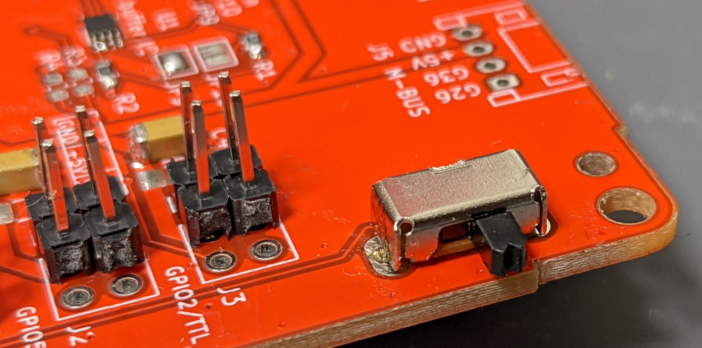
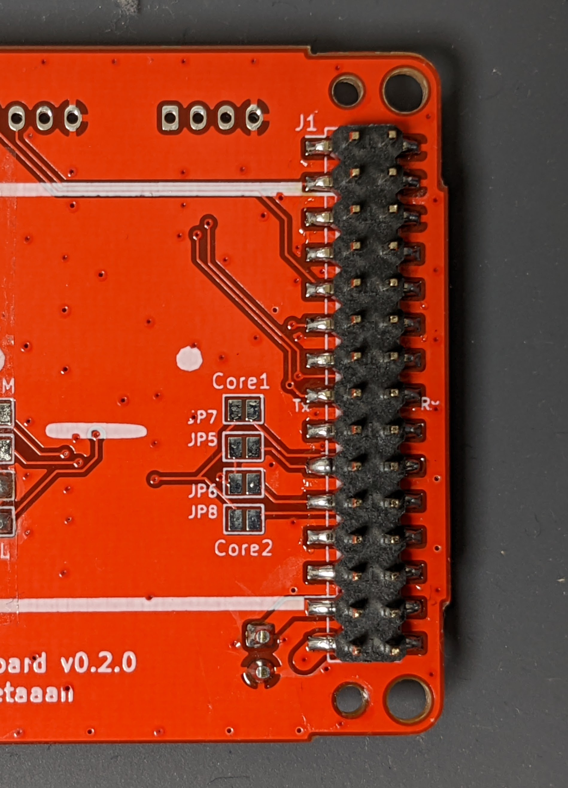

# 路线 D：SCS0009 串行舵机机身（国产串行总线 · 免打板也能玩）

> **Feetech SCS0009 串行舵机 ×2 + 官方专用机身 + M5Stack 主机**。这是官方仓库认可的"国产串行舵机"路线：
> 舵机深圳飞特（Feetech）出品、淘宝直购，能读角度、限流限速、有全状态反馈，比 SG90 高一个档次，比 XL330 便宜且好买。
> 附 **RS30X（Futaba）变体**（日规串行舵机，同思路）。
> 预算约 **¥350–550**（含主机），工期 1 个周末。

## 0. 本路线一览

| 项 | 内容 |
|---|---|
| 主机 | 推荐 CoreS3 + UART→TTL 半双工模块；其他主机/底板按实际 GPIO 配置 |
| 舵机 | Feetech SCS0009 ×2（串行 TTL，半双工） |
| 驱动方式 | 官方底板串行模式（R13/R14），或合格的 UART→TTL 半双工模块 |
| 打印件 | `stl/scs0009/`（4 件，官方专用机身） |
| 固件驱动 | 本指南标定版 `scservo`（raw 零位、量程和限位） |
| 参考角（正前） | 以所购型号实测 raw 中位装配；初次 pan ±10°、tilt ±5° |
| 难度 | ★★★ |

**为什么选它**：串行总线架构（和官方 K151 整机同系列舵机；K151 定制版与市售版不能直接等同）、官方全套专用打印件、舵机国产好买。代价：改 ID 要 URT-1 调试器（一次性 ¥100 上下）；SCS0009 出厂默认 1Mbps 与官方固件 scservo 驱动匹配需核对。

---

## 1. 物料清单（BOM）

| 物品 | 数量 | 参考价(¥) | 说明 |
|---|---|---|---|
| SCS0009 舵机 | 2 | 80–120/个 | 飞特淘宝店/代理；金属齿 2.3kg·cm、300° 量程、全反馈 |
| **URT-1 调试器** | 1 | ~100 | 一次性投入：改 ID/波特率用，飞特配套 |
| M5Stack 主机 | 1 | 100–250 | CoreS3 / Core2 / Core Basic 均可 |
| 官方底板 | 1 | 打样 ¥30 | 串行模式（见 §3.1）；或 UART→TTL 半双工模块（§3.2） |
| 电池 + 耗材 | — | 30–50 | 同 [v0 路线 §1.2](../v0-sg90-route/README.md#12-耗材)，3.7V 400–640mAh PH2.0 |
| 舵机延长线 | 2 | — | SCS0009 配套 3P 线，长短按机身走线 |

### 1.1 打印件（本包 `stl/scs0009/`）

shell_SCS0009、feet_SCS0009、bracket_SCS0009_f、bracket_SCS0009_b。

- **强烈建议直接用这套官方专用机身**：SCS0009 圆形安装法兰原生吻合，含齿轮传动件；别拿 SG90 壳硬改。
- 打印参数同通用（PLA、0.2mm、薄壁 3 层周壁，方向见 [v0 路线](../v0-sg90-route/README.md#13-打印件本包-stlv0-sg90)）。
- STEP 源文件在官方仓库 `case/case_SCS0009/`（同名 .step）。

---

## 2. 舵机初始化（关键步骤，装壳前做完）

1. **两颗舵机设不同 ID**：ID1 = 脚/pan（水平），ID2 = 脸/tilt（垂直）。信号线接法：

   

2. 用 **URT-1 调试器 + 飞特官方 GUI（fddebug）** 改 ID 和角度：

   

3. **注意**：官方提醒**不要用飞特 GUI 的 "Recovery"**（已知会导致舵机工作异常）。
4. 改完 ID 后**一次只连一颗**验证（同 ID 冲突会连不上）。

> SCS0009 规格：300°/1024 步（约 0.293°/步）、330° 传感器、2.3kg·cm、6V、半双工 TTL、出厂默认 1Mbps、ID 范围 0–253；规格书的中位标签与量程定义需结合实测，不把 511 当作通用 90°。完整数据手册：[`../k151-body-route/datasheets/SCS0009_Feetech_Servo.pdf`](../k151-body-route/datasheets/SCS0009_Feetech_Servo.pdf)。

---

## 3. 电气连接（两种玩法）

### 3.1 官方底板串行模式（推荐）

用官方 `m5-pantilt` 底板，**制造文件已生成好**：[`pcb/m5-pantilt-v1.0/manufacture/jlcpcb/`](../pcb/m5-pantilt-v1.0/manufacture/)（Gerber zip + LCSC 号 BOM + 坐标 + 下单说明）。

**串行模式跳线（关键）**：**只装 R13/R14（0Ω）**——R13 把 J3/J8 数据线并成一条半双工总线，R14 接到 MAX3485 收发线（自动换向，CoreS3 的 GPIO17/18；旧 Core 才是 17/16，连接器视图需核对）。**R9–R12 不装**（那是 PWM 模式的 Core 型号选择跳线）。

串行版实拍：

| 端口 | 开关 | 2x15 排座 |
|---|---|---|
|  |  |  |

舵机接 J3/J8（JST EH 3P 口），电池 J5，主机插 J1（背面，注意方向）。

### 3.2 免板方案：UART→TTL 半双工模块

使用带 3.3V UART TX/RX 侧、单线 TTL DATA 侧、收发释放时序说明的模块。默认 CoreS3 TX6/RX7；DATA 并接两颗舵机，舵机独立 5V 供电，主机共地。完整图及要求见 [K151 结构路线 §5](../k151-body-route/README.md#5-接线)。不用 RX 串二极管或普通 USB-TTL TX/RX 短接。URT-1 用于电脑改 ID，与主机 UART 转换器分开选型。

---

## 4. 机械装配

1. 舵机 ID 改好、固件刷好、**两颗舵机停在中位、方向验证正确**之后才动壳（铁律）。
2. 用工具发 raw=512 并实测位置，再断电装摇臂，使头部正前水平。按所购舵机实测量程，不把旧驱动的 100° 或 K151 零位直接套用。
3. 其余流程同 [v0 路线 §3](../v0-sg90-route/README.md#3-机械装配官方动图流程)：bracket 卡舵机 → feet/shell 锁螺丝 → 接线留余量 → 底板 M2×4×4 锁机身 → 插主机。
4. 接线理顺、留活动余量，别让线卡住旋转。

---

## 5. 固件与标定

使用 [自制固件流程](../DIY_FIRMWARE.md)：固定 v1.1.0，复制 `cores3-scs0009.json` **及** `scservo-calibrated-driver.js` 到上游 host/app，再构建通用 CoreS3。

原版 SCServo 协议固定按 200°换算，本路线采购的市售规格是 300°/1024；新驱动使用 raw 命令、显式串口、实测量程和限位，不能只复制 JSON 而漏掉驱动。默认 TX6/RX7@1Mbps，若走 m5-pantilt 则改成 TX17/RX18；主机和舵机波特率必须一致，不自动降到 115200。

先确认 ID1/ID2、raw 零位及方向，再按共用流程量角；零位调 `panZeroRaw/tiltZeroRaw`，不依赖原驱动未使用的 offset 字段。首次范围 pan ±10°、tilt ±5°，运行一次左右 5°、上下 3° 的 MOD。串行应答正常、读回正确、供电及机械无干涉后才扩展范围。本标定驱动未实现电流/温度堵转保护，不宣称与 K151 定制驱动等价。

K151 的 Y 轴 5-85°是该整机机械参考，不是本机舵机 raw 角度的通用限制；自制机按实际机构标定。

---

## 6. 变体：RS30X（Futaba，日规串行舵机）

同一思路的日本品牌版本（Vstone/Best Solution RS30X / RS304MD）：

- 参考角 **0°**（可动 −150~150°），与 SCS0009 的 100° 不同，摇臂对位注意。
- 国内需代购/转运（约 3000 日元+/颗），不推荐国内用户优先选。
- 打印件本包已带：`stl/rs30x/`（shell_RS30X、feet_RS30X、bracket_RS30X）。
- 固件驱动 `rs30x`；官方示例 MOD `setup_rs30x` 可做初始化（见 [firmware-docs/](../firmware-docs/README.md)）。
- 底板同样走串行模式（R13/R14）。

---

## 7. 相关路线

- K151 造型的自制结构路线：[K151 机身路线](../k151-body-route/README.md)（含 K151 机身 + 开源 PCB 混合玩法）
- 更高阶的 Dynamixel 串行路线：[v1.0 + XL330](../v1-xl330-route/README.md)
- 预算优先的 PWM 路线：[v0 + SG90](../v0-sg90-route/README.md)
