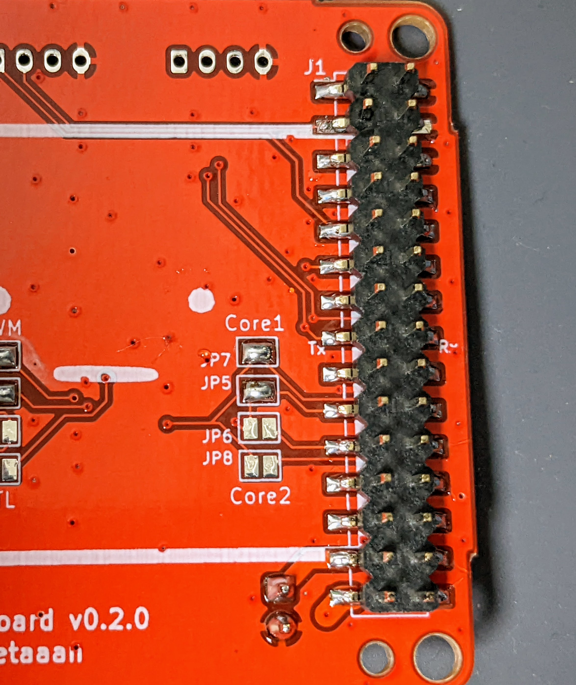
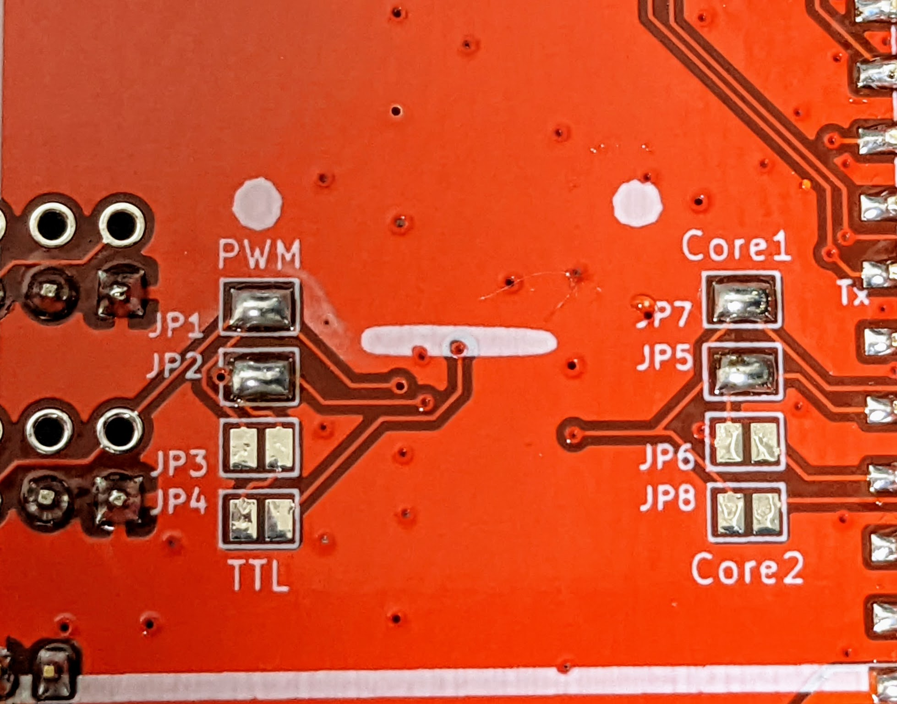
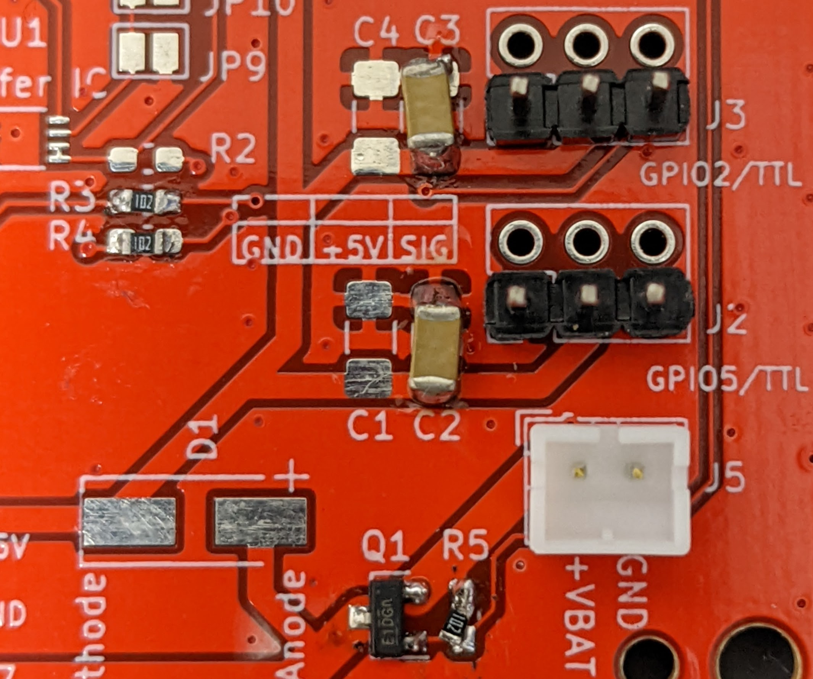
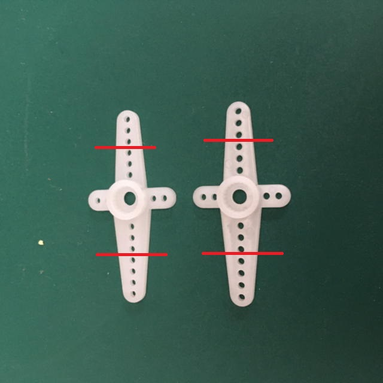
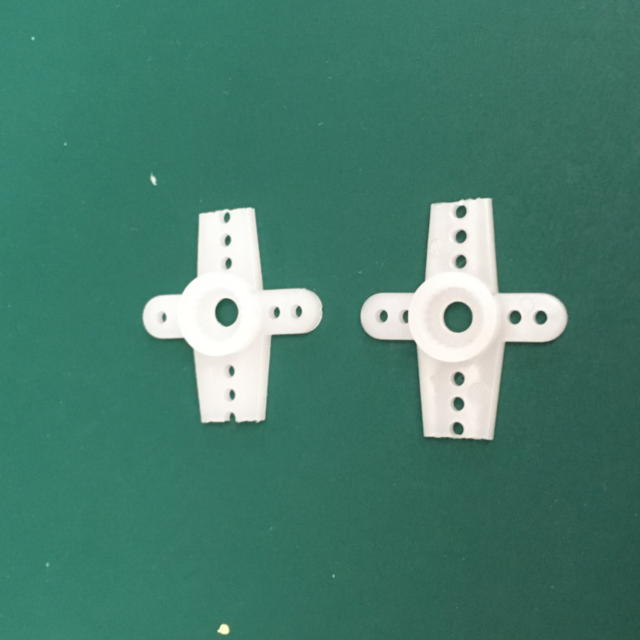
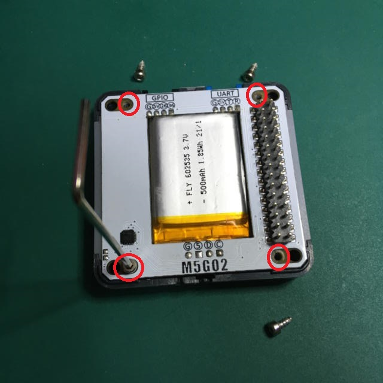
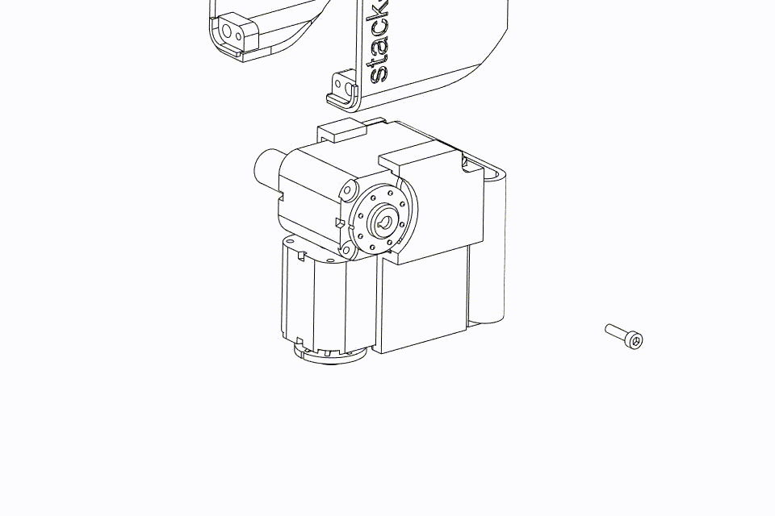
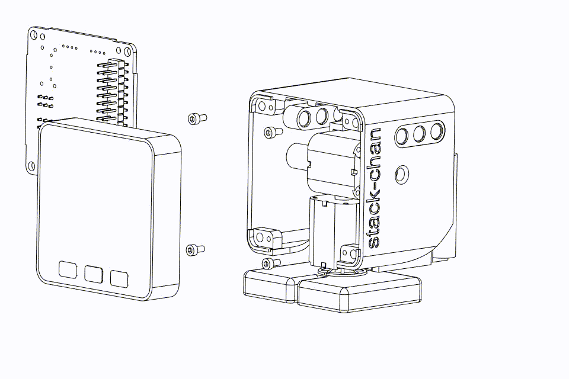
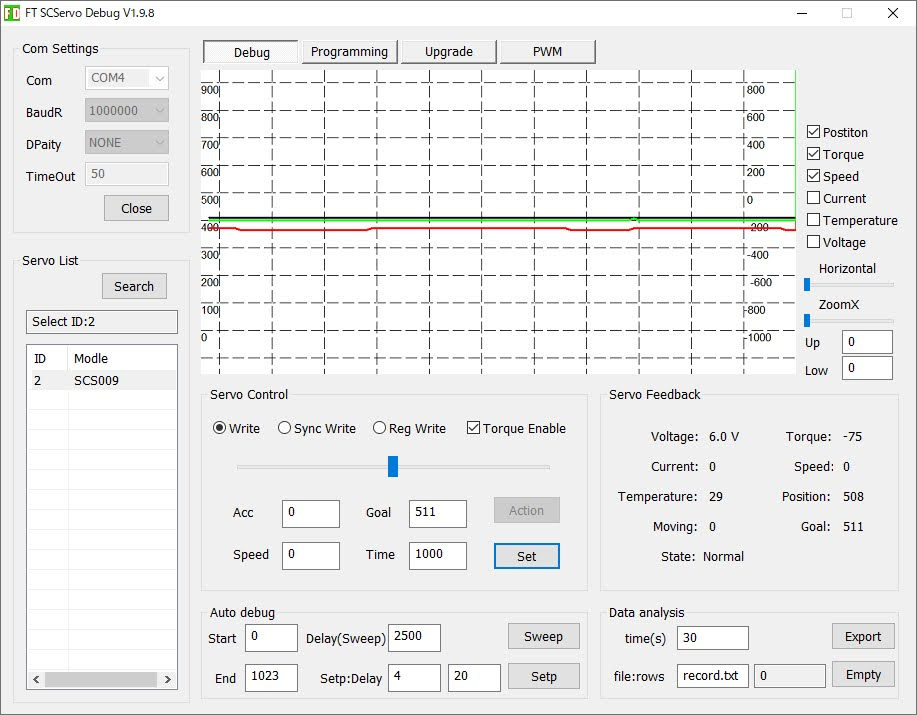

# 路线 C/D：v0 经典机身 + SG90 舵机（性价比之手）

> Stack-chan 最经典、最便宜的自制路线：**v0 官方外壳 + 两颗 SG90 PWM 舵机 + M5Stack Core（Basic/Gray）或 Core2**。
> 含两个省钱变体：**D 丐版直插**（零 PCB，杜邦线直插）和 **M5GO Bottom 版**（mongonta 方案）。
> 预算约 **¥300–500**（含主机；已有主机 + 丐版直插只要 **+¥30**），工期 1 个周末。


## 0. 本路线一览

| 项 | 内容 |
|---|---|
| 主机 | M5Stack Core Basic / Gray（最便宜）或 Core2（带电池喇叭） |
| 舵机 | SG90 ×2（¥5–15/个）；**推荐 MG90S 金属齿** |
| 驱动方式 | PWM（丐版直插免底板；或官方底板 PWM 模式） |
| 打印件 | `stl/v0-sg90/`（5 件） |
| 固件目标 | `com.m5stack`（Core）或 `com.m5stack.core2`（Core2） |
| 参考角（正前） | **90°**，可动 0–180° |
| 难度 | ★★★（打板装壳）/ ★（丐版直插） |

**为什么选它**：主机便宜（Core Basic 二手/闲鱼更便宜）、舵机白菜价、外壳是"纸书封面同款"经典造型。代价：SG90 不能读角度、涌流可能拉掉主机电源、堵转会过热冒烟（官方警告）。

---

## 1. 物料清单（BOM）

### 1.1 核心件

| 物品 | 数量 | 参考价(¥) | 说明 |
|---|---|---|---|
| M5Stack Core Basic / Gray | 1 | 100–200 | Gray 带九轴 IMU；闲鱼收 Basic 更省 |
| M5Stack Core2（可选替代） | 1 | 200+ | 内置电池 + 喇叭，免外接电池 |
| SG90 / MG90S 舵机 | 2 | 10–30 | MG90S 金属齿更耐用 |
| 官方底板（可选，路线 C 正式版） | 1 | 打样 ¥30 | 见 §3；丐版直插不需要 |
| 锂电池（Core Basic 用户） | 1 | 10–20 | 3.7V 400mAh（401230），PH2.0-2P 插头，装 backpack |

### 1.2 耗材

| 物料 | 规格 |
|---|---|
| 螺丝 | M2×4 自攻×4（底板）、M2×8 自攻×2（feet/shell）；可选 M3×15×2 锁主机 |
| 杜邦线 | 母对母/公对母若干（丐版必备） |
| PH2.0 端子线 | 2P 若干 |
| 3D 打印 | PLA/PETG 约 30–50g |

### 1.3 打印件（本包 `stl/v0-sg90/`）

shell_SG90、feet_SG90、bracket_SG90_f、bracket_SG90_b、backpack_400mah（电池背包；640mAh/AAA/卡西欧版在 `stl/backpack/` 按电池换）。

- 材料 PLA 即可，层高 0.2mm，薄壁件 3 层周壁。
- **官方推荐打印方向**（摆错强度差很多）：
- 没有打印机：嘉立创三维猴 https://3d.jlcpcb.com 传 STL 即可，全套几十元；或淘宝"3D打印代打"。
- STEP 源文件在官方仓库 `case/case_SG90/`（与本包 STL 同名），想改外形用 Fusion 360 / FreeCAD 打开。

---

## 2. 舵机接线

### 2.1 变体 D：丐版直插（零 PCB，+¥30 玩起来）

官方固件文档明确给出直插引脚（`manifest_local.json` 配 `driver.type: "pwm"`）：

| 主机 | 端口 | pan（水平）引脚 | tilt（垂直）引脚 |
|---|---|---|---|
| M5Stack Core2 | Port.A | **GPIO 33** | **GPIO 32** |
| M5Stack Core2 | Port.C | **GPIO 13** | **GPIO 14** |
| M5Stack Core Basic/Gray | Port.C | **GPIO 16** | **GPIO 17** |

每颗 SG90 三根线：**信号（橙）接上表引脚、VCC（红）接 5V、GND（棕）接 GND**。舵机吃电流，强烈建议**外接 5V**（USB 充电器 + 杜邦线分压）并**共地**，否则 SG90 启动瞬间可能把主机拉掉电。

### 2.2 变体 C 正式版：官方底板 PWM 模式

用官方 `m5-pantilt` 底板（`pcb/m5-pantilt-v1.0/`），**制造文件已生成好**：Gerber zip + 带 LCSC 号 BOM + 贴片坐标在 [`pcb/m5-pantilt-v1.0/manufacture/jlcpcb/`](../pcb/m5-pantilt-v1.0/manufacture/)，下单流程见其 [README](../pcb/m5-pantilt-v1.0/manufacture/README.md)（2 层 1.6mm，5 片打样约 ¥30）。

**PWM 模式跳线（关键）**：不装 R13/R14（那是串行模式跳线），**按主机型号装 0Ω 跳线**：

| 主机 | 装哪两个 |
|---|---|
| CoreS3 / Core Basic / Gray（PWM1_C1/PWM2_C1 路径） | **R9 + R11** |
| Core2（PWM1_C2/PWM2_C2 路径） | **R10 + R12** |

PWM 版实拍（器件面/排座/跳线位置）：

| 端口 | 开关 |
|---|---|
|  |  |

| 2x15 排座 | 跳线 | 元件面 |
|---|---|---|
|  |  |  |

舵机 3P 头直接插 J3/J8 舵机口，电池接 J5（PH2.0），主机插 J1 排母（J1 在**背面**，注意方向）。

### 2.3 变体：M5GO Bottom 版（mongonta 方案，免自制板）

M5GO Bottom 底座 + SG90，日本 mongonta 的成熟方案，装配图 11 张：

  

（全套：`images/m5go_assembly01.jpg` ~ `m5go_assembly11.jpg`，本目录已存；带猫耳/河马耳/LEGO 孔装饰件。套件代购 https://mongonta.booth.pm/ ）

---

## 3. 机械装配（官方动图流程）

**三条铁律**（官方原文）：

1. **先刷固件、舵机方向验证正确，再固定进壳**——装反通电就顶壳。
2. 摇臂对准**参考角 90°**（SG90 正前方）再装十字盘。
3. 接线理顺、留活动余量，别让线卡住旋转。

官方装配动图：

| 1. 舵机卡进 bracket + 电池入 backpack | 2. feet 与 shell 锁螺丝 | 3. 接底板 + 装 M5Stack |
|---|---|---|
|  |  |  |

文字版：

1. 舵机先**不上壳**：接好线、刷固件，确认两颗舵机停在中位、方向正确。
2. 对准 90° 参考角装摇臂（十字盘凸起对齐）。
3. 两颗 SG90 卡进 bracket；电池塞进 backpack，卡进 bracket。
4. feet 和 shell 用 M2×8 各 1 颗固定。
5. 舵机线、电池线接底板（**仔细核对插针方向**）：

   

6. 底板 M2×4 ×4 锁到机身，M5Stack 插到 J1 排母上；想锁死主机用底部两孔 M3×15。

---

## 4. 固件

### 4.1 刷机（三选一）

- **网页刷机（首选）**：Chrome/Edge 打开 https://stack-chan.github.io/stack-chan/web/flash/ ，选 `M5Stack` / `M5Stack Core2` 目标。
- **离线包**：本仓库 [`firmware/stack-chan-firmware-v1.1.0.zip`](../firmware/stack-chan-firmware-v1.1.0.zip) 内 `com.m5stack`（Core）或 `com.m5stack.core2`（Core2）文件夹，esptool 三件套（ESP32 布局：bootloader@0x1000、partition-table@0x8000、app@0x10000）：

  ```bash
  esptool --chip esp32 --port /dev/ttyACM0 --baud 921600 \
    write_flash 0x1000 bootloader.bin 0x8000 partition-table.bin 0x10000 xs_esp32.bin
  ```

- **npm 源码构建**：`npm run build / deploy` + `--target com.m5stack` 系列参数，详见主指南通用章节。

### 4.2 驱动配置（丐版直插/非标准引脚必改）

编辑固件仓库 `firmware/host/app/manifest_local.json`：

```json
{
  "include": ["./manifest.json"],
  "config": {
    "driver": {
      "type": "pwm",
      "pwmPan": 16,
      "pwmTilt": 17
    }
  }
}
```

（上例 = Core Basic Port.C 引脚；Core2 Port.A 用 33/32。）用官方底板 PWM 模式 + 标准主机时**无需配置**，对应目标已预置。

> Takao（mongonta）Core2 + SG90 有专用快捷目标：`npm run flash:takao_core2_sg90`（pwm，pan 19 / tilt 27）。

### 4.3 验收

**官方验收标准**：按 A 键每 5 秒随机看向一处、B 键依次看向左右上下、C 键表情反色。**会左右摇头 = 驱动配置成功。**

---

## 5. 常见坑

| 症状 | 原因 | 处理 |
|---|---|---|
| 一动就黑屏重启 | SG90 涌流拉掉主机电源 | 外接 5V 供电 + 共地；或走底板（有电源路径管理） |
| 舵机抖个不停 | PWM 引脚配置错 | 核对 manifest_local 的 pwmPan/pwmTilt |
| 摇臂方向反了 | 没对 90° 参考角 | 重刷固件回中位后重装摇臂，勿硬掰 |
| 摇臂装不进 | 公差问题 | 用锉/刀轻扩孔；别换错件 |
| 堵转发烫 | 机械卡死 | **立即断电**——SG90 堵转可能冒烟（官方警告） |

## 6. 想升级？

- 嫌 SG90 没反馈/不够精致 → 看串行舵机路线：[SCS0009 串行路线](../scs0009-serial-route/README.md) 或 [v1.0 + XL330 路线](../v1-xl330-route/README.md)。
- 底板老规格（v0.2.1 时代图纸）在官方仓库 tag `v0.2.1`：https://github.com/stack-chan/stack-chan/tree/v0.2.1/schematics （与 main 分支 v1.0 板不通用，本路线用 main 分支板即可）。
- MOD 玩法/进阶固件文档：见 [firmware-docs/](../firmware-docs/README.md)。
