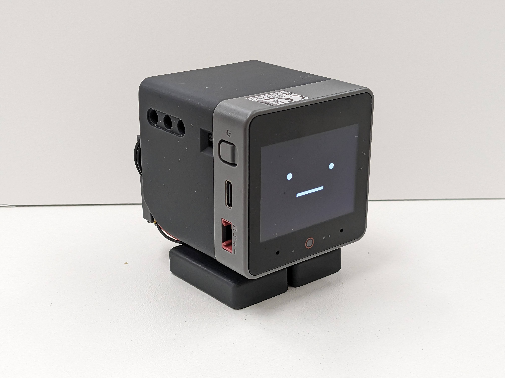
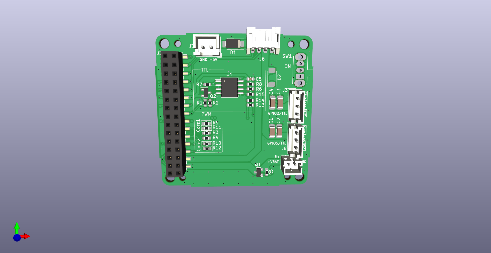
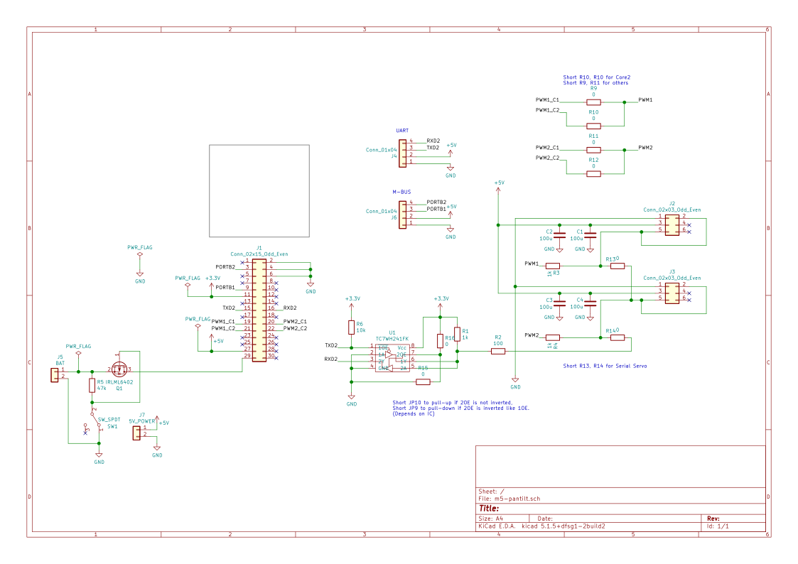
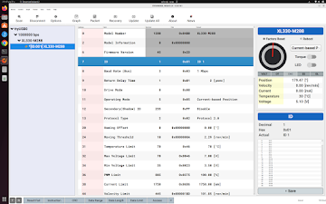
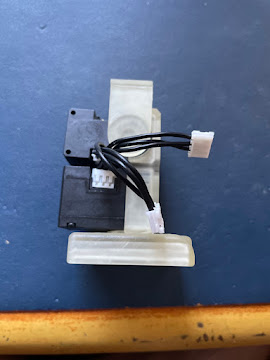
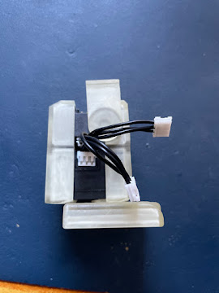
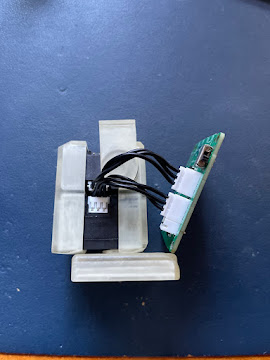
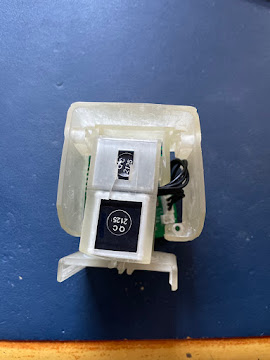

# v1.0 官方外壳手搓路线（CoreS3 + XL330）：方案与完整教程

> 本目录是主教程《[StackChan 手挫完全指南](../README.md)》的第二个独立子路线（另一个是 [`k151-body-route/`](../k151-body-route/README.md)）：
> **stack-chan v1.0 官方开源外壳 + Robotis XL330 串行舵机 + 开源底板 + M5Stack CoreS3**。
> 这是官方文档定义的**标准 v1.0 DIY 配方**——外壳、底板、固件全开源，没有黑盒环节。



---

## 0. 一句话结论

- v1.0 外壳官方文档明确**只支持 DYNAMIXEL（XL330）**舵机（`case/v1/dynamixel.md` 原文）。
- 舵机选 **XL330-M288-T**×2（扭矩优先；要速度选 M077-T）。
- 全部资料都是一手官方件：外壳 STL（开源）、底板 KiCad（开源）、固件（开源），本包已附带。
- **预算（估算）：¥500–750**（CoreS3 ¥199–249 + XL330×2 ¥200–300 + 打样 ¥30 + 打印 ¥50–100 + U2D2 调试器 ¥200–300 一次性）。

---

## 1. 为什么这是"官方标准配方"

| 环节 | 官方出处 | 开源状态 |
|---|---|---|
| 外壳 8 件 STL | `stack-chan/stack-chan` 仓库 `case/v1/`（含官方装配指南 `dynamixel.md`，本包 [reference/](reference/) 已存档） | ✅ |
| 底板 m5-pantilt v1.0 | 同仓库 `case/pcb/m5-pantilt-v1.0/`（KiCad 工程 + 原理图，本包 [`../pcb/m5-pantilt-v1.0/`](../pcb/m5-pantilt-v1.0/)） | ✅ |
| 固件 | 同仓库 `firmware/`（预编译包 + 源码，本包 [`../firmware/`](../firmware/)） | ✅ |
| 主控 | M5Stack CoreS3（商品件） | 硬件闭源、SDK 开放 |

三样官方件互相就是为彼此设计的：**底板孔位 = v1.0 外壳螺丝位；底板 J3/J8 舵机口 = XL330 TTL 半双工总线（自动换向电路就是为 Dynamixel 协议设计的）；固件目标 `com.m5stack.cores3` = CoreS3 + XL330 标准机**。零适配成本。

---

## 2. 舵机选型：XL330-M288-T

| 型号 | 减速比 | 堵转扭矩@5V | 空载转速 | 建议 |
|---|---|---|---|---|
| **XL330-M288-T** | 288:1 | ≈0.51 N·m | ≈114 RPM | ✅ **推荐**：扭矩大，转头稳，stack-chan 场景速度足够 |
| XL330-M077-T | 77:1 | ≈0.39 N·m | ≈180 RPM | 要快转头/轻负载时选 |

共同规格（以 Robotis e-Manual 为准：https://emanual.robotis.com/docs/en/parts/x/xl330/ ）：

- TTL 总线半双工，协议 2.0，**出厂 ID=1、波特率 57600**（都要改，见 §6）
- 电压 3.7–6.0V，重量约 23g，全金属齿，位置/速度/温度/负载全反馈
- 采购：淘宝搜"XL330-M288"（Robotis 授权代理店，约 ¥100–150/只）；确认是 **-T（TTL）** 版本，不是 -R（RS-485，接口不同装不了）

---

## 3. 采购清单（BOM）

### 3.1 核心件

| # | 物品 | 规格 | 数量 | 参考价(¥) | 渠道 |
|---|---|---|---|---|---|
| 1 | M5Stack CoreS3 | K128 | 1 | 199–249 | 淘宝 M5Stack 官方店 |
| 2 | XL330-M288-T | TTL 串行舵机 | 2 | 100–150/只 | Robotis 淘宝代理店 |
| 3 | m5-pantilt v1.0 底板 | 自己打样（§5） | 1 | 30–50 | 嘉立创 |
| 4 | TTL 通信线 | 4cm，3 pin | 2 | 5/条 | 代理店有售 / 杜邦线代 |
| 5 | 5V 电源 | USB 适配器 ≥2A | 1 | — | 已有 |
| 6 | M2×4 盘头自攻螺丝 | 底板固定 | 4 | ~2 | 螺丝包 |
| 7 | M2.5×6 自攻螺丝 | 舵机固定（**XL330 附带**） | 2 | 0 | — |

### 3.2 舵机调试工具（改 ID/波特率用，一次性投资）

| 物品 | 参考价(¥) | 说明 |
|---|---|---|
| **U2D2 + SMPS2Dynamixel**（官方推荐） | 200–300 | RoboTiS 官方调试器，Dynamixel Wizard 2 完美支持；以后玩其他 Dynamixel 设备也能用 |
| 省钱替代 | 0–15 | 任何 3.3V USB-TTL 模块，TX/RX 短接成半双工接舵机数据线（Wizard 2 可识别部分 CH340/CP2102 设备，运气成分；或找卖家代改 ID/波特率） |

### 3.3 打印件（§4）

外壳 8 件：自己打印 ¥30–80（耗材），或嘉立创三维猴/淘宝代打 ¥60–120。

**预算汇总：¥500–750**（不含 U2D2 则 ¥300–450）。

---

## 4. 3D 打印

文件在本包 [`../stl/v1-xl330/`](../stl/v1-xl330/)（官方原版）：

| 文件 | 部位 | 数量 | 说明 |
|---|---|---|---|
| shell.stl | 脸壳 | 1 | 0.12mm 层高 + 支撑，浅色 PETG |
| feet_top.stl / feet_bottom.stl | 底座上下 | 各 1 | 0.16mm |
| bracket_XL330_f / bracket_XL330_b | 舵机前后支架 | 各 1 | **强度件**，PLA+/PETG，40% 填充 |
| gear_XL330.stl | 舵机齿轮 | 2 | 0.12mm；**孔位公差按打印精度已放大** |
| gear_XL330_narrow.stl | 窄孔备选 | 备用 | 齿轮装上晃/打滑时换它 |
| horn.stl | 舵机角（脖子转接） | 1 | 0.12mm |


打印参数：3 壁、20% 填充（强度件 40%）、PETG 或 PLA+。改尺寸需求用 STEP 源文件（仓库 `case/v1/`）在 Fusion 360/FreeCAD 里编辑。

---

## 5. 底板：三种选择

### 5.1 自己打样 m5-pantilt v1.0（推荐）

KiCad 完整工程在本包 [`../pcb/m5-pantilt-v1.0/`](../pcb/m5-pantilt-v1.0/)。要点先记住：

- 两层板，~¥30（打样）+ 可选 ~¥20（SMT 经济套餐）
- 串行舵机模式跳线：**只装 R13/R14**（0Ω）；**R9–R12 不装**——它们是 PWM/SG90 模式下选 Core 型号用的（R10=Core2，R9+R11=其他），串行模式用不到
- XL330 @1Mbps 是这块板的**原生设计工况**（自动换向电路就是为 Dynamixel 设计的），无需降速
- **制造文件已生成好**：`../pcb/m5-pantilt-v1.0/manufacture/jlcpcb/`（Gerber zip + 带 LCSC 号的 BOM + 贴片坐标，嘉立创直接上传，见 5.1.3）




串行版（本路线）舵机口与拨动开关实拍：


#### 5.1.1 这块板是什么

官方开源底板 `m5-pantilt` 的功能：

- 驱动两颗串行舵机（J3/J8 两个 3-pin TTL 口，自动换向半双工总线）
- 双 30-pin 排母（J1/J2）直插 M5Stack 背面 M-BUS
- 外部 5V 供电口、电池供电，且**可经 M5Stack 给电池充电**
- （可选）电源开关

信号与供电细节见原理图截图（下图）与完整原理图 PDF（`../pcb/m5-pantilt-v1.0/m5-pantilt.pdf`）。



#### 5.1.2 工程文件清单（本包已附带）

```
../pcb/m5-pantilt-v1.0/
├── m5-pantilt.kicad_pro / .kicad_sch / .kicad_pcb   ← KiCad 工程（main 分支 = v1.0 规格）
├── m5-pantilt.pdf                                    ← 原理图 PDF（核对元件用）
├── m5-pantilt-all-pos.csv                            ← 贴片坐标（CPL），仓库官方提供
├── m5-pantilt.kibot.yaml                             ← KiBot 一键生成嘉立创制造文件的配置
├── gerber/                                           ← 仓库只提交了丝印 + 钻孔
│   ├── m5-pantilt-B_Silkscreen.gbo
│   ├── m5-pantilt-F_Silkscreen.gto
│   └── m5-pantilt-NPTH.drl / m5-pantilt-PTH.drl
├── m5-pantilt.pretty/                                ← 自定义封装库
└── 其他工程配套文件（lib/sym-lib-table/cache 等）
```

**制造文件已生成好，无需自己导出**：[`manufacture/jlcpcb/`](../pcb/m5-pantilt-v1.0/manufacture/) 里有嘉立创三件套——`m5-pantilt-gerbers-jlcpcb.zip`（Gerber+钻孔）、`m5-pantilt-bom-jlc.csv`（BOM，**含官方原理图自带的 LCSC 编号**）、`m5-pantilt-cpl-jlc.csv`（贴片坐标），以及人类可读的 [`BOM.md`](../pcb/m5-pantilt-v1.0/manufacture/jlcpcb/BOM.md) 和下单注意事项 [`manufacture/README.md`](../pcb/m5-pantilt-v1.0/manufacture/README.md)。直接跳到 5.1.4 下单即可。

> 官方仓库只提交了丝印 + 钻孔（铜层 Gerber 在 `.gitignore` 里），上述文件是用 `kicad-cli` 从官方 KiCad 工程生成的，复现命令在 manufacture/README.md 文末。想自己生成（或改板后重出）再看下面两种方法。

#### 5.1.3 （可选）自己生成制造文件

**方法 A：KiBot 一键生成（推荐，配置官方已写好）**

1. 安装 [KiCad](https://www.kicad.org/)（建议 7/8 版本）与 KiBot：
   ```bash
   pip install kibot
   ```
2. 在 `pcb/m5-pantilt-v1.0/` 目录执行：
   ```bash
   kibot -c m5-pantilt.kibot.yaml -e m5-pantilt.kicad_sch -b m5-pantilt.kicad_pcb
   ```
3. 生成物在 `generated/` 下，其中 `Manufacturers/JLCPCB/` 是给嘉立创的 Gerber/BOM/坐标文件，另有 `BoM/Generic/` 的通用 BOM（HTML/XLSX）。

**方法 B：KiCad 手动导出（不装 KiBot）**

1. 用 KiCad 打开 `m5-pantilt.kicad_pcb` → 文件 → 制造输出 → Gerbers（导出含铜层+丝印+阻焊+钻孔，打包 zip）。
2. 贴片坐标：文件 → 制造输出 → 元件位置文件（.pos / .csv）；也可以直接用官方给的 `m5-pantilt-all-pos.csv`。
3. BOM：原理图工具 → BOM 导出（或直接对照 `m5-pantilt.pdf` 手抄，见 5.1.4）。

#### 5.1.4 核对元件清单（BOM）

完整 BOM（23 组、带 LCSC 号）见 [`manufacture/jlcpcb/BOM.md`](../pcb/m5-pantilt-v1.0/manufacture/jlcpcb/BOM.md)，由 KiCad 原理图自动生成。核心构成：

| 类别 | 元件 |
|---|---|
| IC | **U1 = MAX3485**（SO-8，半双工收发）、Q1 = IRLML6402（电源软开关）、Q2 = BC857（方向控制） |
| 二极管 | D1 = SS54、D2 = PMEG3030EP |
| 阻容 | 100µ×4、0.1µ×1；0603 电阻×15（其中 **R13/R14 = 0Ω 跳线，串行模式必装**） |
| 连接器 | J1/J2 = 2×15 M-BUS 排母/排针（**J1 在背面**）、J3/J8 = JST EH 3pin 舵机口、J5 = PH2.0 电池、J7 = XH 5V |
| 手插件 | J6（PH 4pin）、SW1（SPDT 开关，可选） |

> 官方仓库自带的旧版 CPL 只有 3 个件，不完整；以本包生成的 BOM 为准，下单前仍建议对照原理图 PDF 抽查一遍。

#### 5.1.5 嘉立创下单（两种玩法）

**玩法 1：只打裸板，全部手焊（最省钱，元件少到 15 分钟焊完）**

1. 打开 https://www.jlc.com （嘉立创）→ PCB 下单。
2. 上传 5.1.3 生成的 Gerber 压缩包 → 自动解析。
3. 参数：2 层、板厚 1.6mm（按个人喜好 1.0 也行）、表面处理默认喷锡、数量 5 片。
4. 新客常有 5 片 ¥2 级别活动；提交付款，一般 2–4 天到货。
5. 到货后手焊：先 SMD（U1/Q1/Q2/阻容/R13/R14 跳线），再插件。**J1 在背面立贴，焊接时注意方向**（照 `images/m5-pantilt-bottom.png`）。

**玩法 2：让嘉立创 SMT 贴片（省焊接）**

1. PCB 下单时勾选 **SMT 贴片**，上传 BOM + 坐标（用 `m5-pantilt-all-pos.csv` 或方法 A 生成的 JLC 格式坐标）。
2. 元件匹配页面按 LCSC 号确认各元件。**两个关键点**：① J1 在 bottom 面——经济贴装只贴单面，建议 J1 免贴到手自己焊（或选双面贴装加价）；② **把 R9/R10/R11/R12 设为"不贴"**（串行模式不用，见 5.1 跳线说明）。
3. 付款等待，到手后手焊剩余插件件。

**打样完成后**：万用表蜂鸣档查 5V/GND 是否短路，再上 M5Stack 试机。

### 5.2 买现成套件

mongonta（高木貴昭）的 Stack-chan 组装套件（日本 BOOTH）：https://mongonta.booth.pm/ —— 含底板和全部结构件，免去打样，但日本直邮周期长。

### 5.3 免板直插（丐版）

不想打板可以复用 K151 路线的二极管法（见 [`../k151-body-route/README.md`](../k151-body-route/README.md) §5）：TX17→220Ω→总线，RX16←二极管←总线，5V/GND 给舵机。能用，但失去自动换向、软开关和滤波。

---

## 6. 舵机配置（改 ID 与波特率，装车前必做）

**XL330 出厂：ID=1、57600bps；stack-chan 要求：腿(pan)=ID 1、脖(tilt)=ID 2、1000000bps。**



官方流程（U2D2 + SMPS2Dynamixel + 5V 适配器）：

1. 装官方工具 **Dynamixel Wizard 2**（https://emanual.robotis.com/docs/en/software/dynamixel/dynamixel_wizard2/ ，Win/Mac/Linux 都有）。
2. **一次只接一只舵机**（同 ID 冲突会搜不到），Options 选 U2D2 的串口 → Scan。
3. 选中舵机 → 把 **Baud Rate 改 1000000** 保存；第二只再把 **ID 改 2** 保存。
4. 改完用 1Mbps 重新 Scan 一次确认两只都在。

| 舵机 | ID | 波特率 | 位置 |
|---|---|---|---|
| 腿（pan，水平） | 1 | 1000000 | 下层（装 gear 插 feet_top） |
| 脖（tilt，垂直） | 2 | 1000000 | 上层（装 gear + horn） |

---

## 7. 装配 10 步（官方指南中文化，图=官方原图）


**装腿舵机（ID=1）**

1. 把 gear_XL330（小十字件）压入 ID=1 舵机——对准齿轮上的凸台与 XL330 轴孔。


2. 插入 feet_top（带缺口凸台的方向为前方），从背面用 M2.5×6 自攻螺丝固定；再滑入 feet_bottom。


**装脖子舵机（ID=2）**

3. 同样给 ID=2 舵机压入 gear_XL330，M2.5×6 螺丝固定。

4. 装上 horn（脖子转接件）。


**合体**

5. 接好两只舵机的 4cm TTL 线。


6. 用 bracket_XL330_f（前）把上下两只舵机组合。



7. 用 bracket_XL330_b（后）锁紧上下舵机。



8. 底板与两只舵机用 TTL 线相连。



9. 把 horn 滑入 shell（脸壳）。



10. 底板与 shell 用 4 颗 M2×4 自攻螺丝固定，最后插入 CoreS3。


> 铁律（同主指南 §6.1）：**绝不通电硬拧舵机**；脖子（tilt）行程保持软件限位内。

---

## 8. 固件

### 8.1 预编译包（推荐先用这个）

本包 [`../firmware/stack-chan-firmware-v1.1.0.zip`](../firmware/)（SHA-256 已验）里的 **`com.m5stack.cores3`** 目标就是 CoreS3 + XL330 标准机：

- 网页刷机（零环境）：https://stack-chan.github.io/stack-chan/web/flash/ → 选 CoreS3 + XL330 标准机
- 离线 esptool（S3 布局）：

```bash
esptool --chip esp32s3 --port /dev/ttyACM0 --baud 921600 \
  write_flash 0x0 bootloader.bin 0x8000 partition-table.bin 0x10000 xs_esp32.bin
```

### 8.2 源码构建（要改配置/MOD 开发）

```bash
git clone https://github.com/stack-chan/stack-chan.git
cd stack-chan/firmware
npm i && npm run setup -- --device=esp32 && npm run doctor
```

`manifest_local.json` 写入 dynamixel 驱动（底板舵机总线 = UART2，TX17/RX16）：

```json
{
  "include": ["./manifest.json"],
  "config": {
    "driver": {
      "type": "dynamixel",
      "panId": 1,
      "tiltId": 2,
      "offsetPan": 0,
      "offsetTilt": 0,
      "serial": { "port": 2, "transmit": 17, "receive": 16, "baud": 1000000 }
    }
  }
}
```

```bash
npm run build:m5stackchan_cores3   # 构建验证（目标芯片同为 ESP32-S3）
npm run deploy                     # 烧录
```

> 佐证：官方固件平台清单里 `stackchan_rt`（同为 CoreS3+XL330 的商业化版本）锁定的就是 `dynamixel` 驱动、ID 1/2、1Mbps——协议参数与上表一致，只有总线引脚因板子不同而异。
> 装歪了用 `offsetPan` / `offsetTilt`（度）微调，不用拆舵机。

### 8.3 验收

上电几秒出脸。**A** 键每 5 秒随机看向一处、**B** 键依次看左右下上、**C** 键表情反色。**会左右摇头 = 成功。**
串口日志可确认驱动实际参数，形如：`[dynamixel] serial port=2 tx=17 rx=16 baud=1000000`。

---

## 9. 故障排查

| 症状 | 原因 | 解法 |
|---|---|---|
| Wizard 搜不到舵机 | 波特率不匹配（出厂 57600） | Scan 时勾选全波特率扫描；先 57600 连上再改 1M |
| 两只都 ID=1 搜不到 | 同 ID 冲突 | **一次只接一只**改，第二只改 ID=2 |
| 刷固件后舵机不动 | 波特率没改（还是 57600） | 回 §6 用 Wizard 改 1M |
| 齿轮打滑/旷量 | 打印公差 | 换 `gear_XL330_narrow.stl` |
| 头歪了 | horn/gear 装配相位不准 | 固件 `offsetPan/offsetTilt` 微调 |
| 转头无力异响 | 供电不足 | 5V ≥2A；确认 TTL 线 3 pin 全接触 |
| 摸舵机烫 | 长时间堵转 | 断电检查机械干涉；XL330 有温度反馈可读 |

---

## 10. 本路线 vs 其他路线

| | 本路线（v1.0+XL330） | K151 官方机身 | v0+SG90 |
|---|---|---|---|
| 官方文档完备度 | ★★★（专属装配指南） | ★（只有 STL） | ★★ |
| 舵机性能 | 高（扭矩+全反馈） | 高（SCS0009） | 低（SG90 无反馈） |
| 电子件难度 | 打板/焊接 | 二极管直连或魔改 | 官方底板/直插 |
| 预算 | ¥500–750 | ¥450–650 | ¥300–500 |
| 适合 | 完整手挫、玩 MOD、长期折腾 | 颜值党、第二台 | 第一台验证兴趣 |

---

## 附录 A：本目录素材清单

| 路径 | 内容 |
|---|---|
| `images/`（27 个） | 官方 v1.0 装配图 dynamixel_01–10、成品图 front/side、Dynamixel Wizard 截图、底板实拍、打印方向、bracket/shell 装配动图等（均取自官方仓库 `case/docs/images/`，已在本包 images/ 中，此处为路线独立副本） |
| `reference/` | 官方 v1.0 装配指南原文（英文/日文 Markdown，`stack-chan` 仓库 `case/v1/dynamixel.md`） |
| `../stl/v1-xl330/`（8 件 STL + gear 备选） | v1.0 外壳官方原版 |
| `../pcb/m5-pantilt-v1.0/` | 底板 KiCad 完整工程 + 原理图 PDF + **已生成的嘉立创制造文件包**（Gerber zip / BOM / CPL，见其 `manufacture/`） |
| `../firmware/` | 官方固件 v1.1.0 离线包（SHA-256 已验） |

## 附录 B：来源

- 官方 v1.0 装配指南：github.com/stack-chan/stack-chan `case/v1/dynamixel.md`（BOM、ID/波特率表、10 步装配图）
- 外壳 STL：同仓库 `case/v1/`；底板：`case/pcb/m5-pantilt-v1.0/`
- 舵机规格与出厂值（ID=1/57600bps）：Robotis e-Manual XL330 页与官方指南一致
- 固件平台/驱动定义：同仓库 `firmware/docs/flashing-firmware.md` 及 `host/platforms/stackchan_rt/manifest.json`（dynamixel、ID 1/2、1Mbps 的官方锁定值）
- XL330 购买：Robotis 官方代理（淘宝）；调试器 U2D2 + SMPS2Dynamixel（官方推荐组合）

*本文档为社区 DIY 指南。Stack-chan、ROBOTIS DYNAMIXEL、M5Stack 商标归各自所有者。*
